## A systems-level approach to human auditory neuroscience
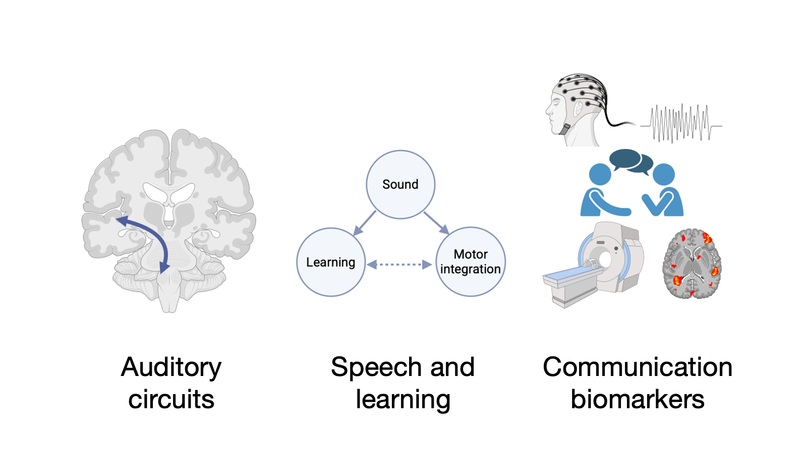{fig-align="center" height='900'}

::: {.notes}
Identifying brain structure and function in *atypical communication*, and learning new questions to ask neuroscience

(not necessarily to diagnose, but rather to identify neural characteristics associated with a disorder, and perhaps to optimize treatment)

Established collaborations:
- Functional and structural connectivity in **persistent developmental stuttering** (Sitek et al., 2016; ongoing Pitt collaboration)
- Speech feedback control in individuals with **cerebellar stroke** (R01 Co-Investigator; PI: Bohland)
- White matter pathways in **autism spectrum disorder** (Boets et al., 2018)
- White matter integrity in **sensorineural hearing loss** (Tarabichi et al., 2018)
:::

## A systems-level approach to human auditory neuroscience {.unlisted visibility="hidden"}
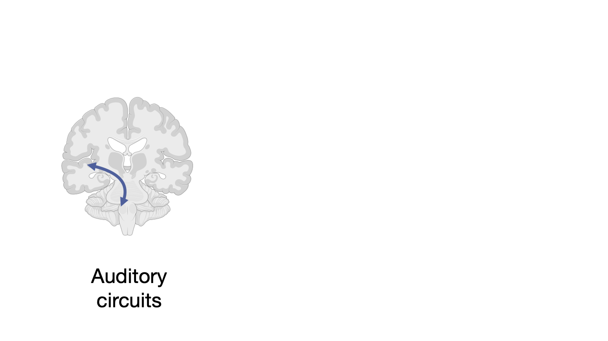{fig-align="center" height='900' .fragment}

## A systems-level approach to human auditory neuroscience {.unlisted visibility="hidden"}
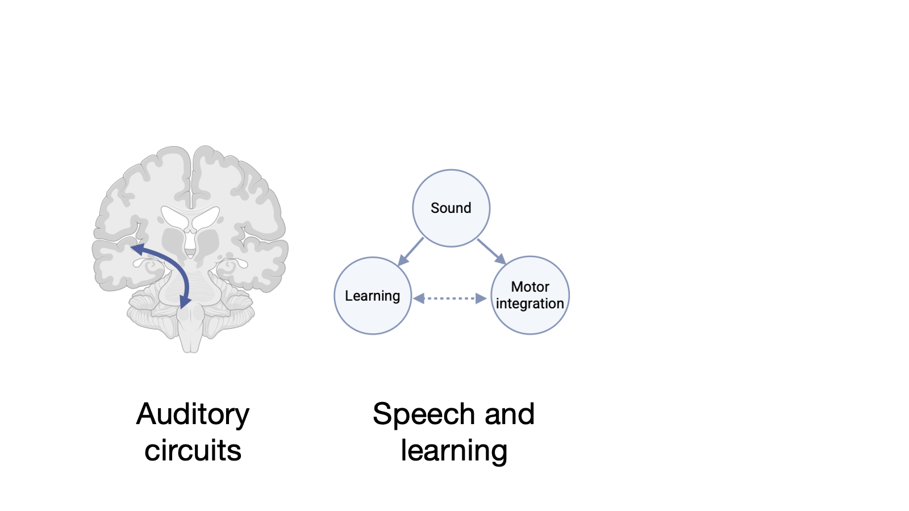{fig-align="center" height='900'}

::: {.notes}
Sensory behavior - how we use auditory information to learn about and act in the world
:::

## Communication neuroscience at Northwestern (2023–now)

:::: {.columns}

::: {.column .fragment}
### Mapping the human subcortical auditory system
- **Functional connectivity** (Chandra\* & Sitek\* et al., 2024)
- **Multi-echo fMRI** improves subcortical sensitivity at 3T (**Michelle Medina**, Molly Bright; Medina et al., 2026 *Hearing Research*; Medina et al., 2026 *bioRxiv*)
- **FFRPrep**: open, standardized FFR preprocessing (**Max Chen**, Peer Herholz; Sitek et al., OHBM 2026; in prep.)
- **Neurovascular organization** (Xu et al., ISMRM 2025; Xu, ..., S. Bollmann\*, Sitek\*, in prep.)
- **Corticostriatal pathways** in humans (Sitek et al., in revision)
:::
::: {.column .fragment}
### Behavior of the human auditory system
- **Auditory–motor interactions** across the auditory pathway (**Laura Raiff**, **Gabby Butler**; Raiff\* & Butler\* et al., 2026 *bioRxiv*; Raiff et al., in prep.)
- **Auditory category learning** (Sitek et al., in revision; Deschamps, et al., in prep.)
- **Bayesian spatial mapping** of learning-task fMRI (Moya et al., 2026 *arXiv*)
- **Top–down modulation of predicted sound processing** across the auditory pathway (Ara et al., 2024)
- **Speech-in-noise processing** in the developing brain (Sitek et al., SNL 2025; in prep.)
:::
::::

::: aside
This work is actively supported by K01-DC019421 and R21-DC022906. Mentees are **in bold**.
:::

::: {.notes}
Bold names = Northwestern mentees.
:::

# Mapping and connectivity of the human subcortical auditory system

::: {.notes}
Speaker notes go here.
:::

## What's special about the auditory system? {visibility="hidden"}

::: {layout="[60,40]"}

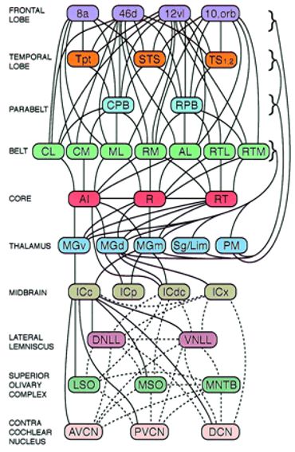{fig-align="center" height='800'  .fragment}

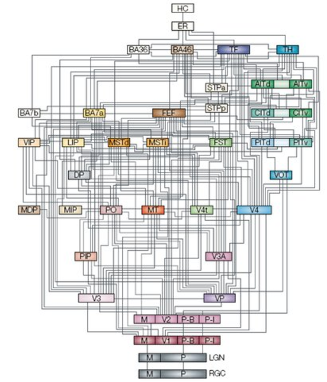{fig-align="center" height='800'  .fragment}

:::

## What's special about the auditory system? {visibility="hidden"}

::: {layout="[60,40]"}

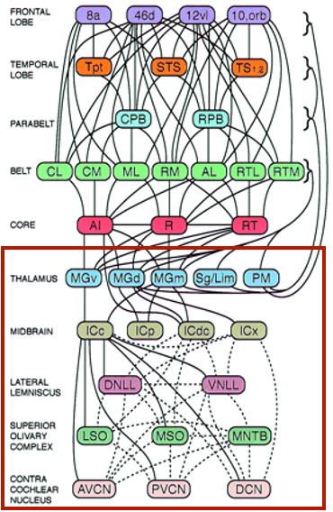{fig-align="center" height='800'}

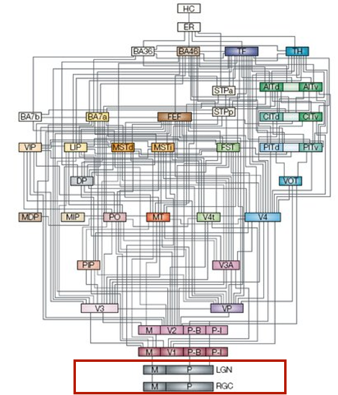{fig-align="center" height='800'}

:::

::: {.notes}
So why should we focus on the subcortical parts of the auditory system? I said that those are the harder parts to investigate with MRI, right? Well, there’s actually a lot going on in the brainstem and thalamus, especially in the auditory system.
Two examples from primates show differences between the wiring of the auditory and visual systems. In the auditory system, the first 5 layers of the system are subcortical, and with some cross-talk between them, so some processing can pass through even more structures.
Meanwhile, in the visual system, there’s just one or two stages before hitting primary sensory cortex. Indeed, a lot of processing is already done by the retina itself. With other features extracted later in successively higher levels of visual cortex.
Whereas in the auditory system, there’s some basic frequency and sound level information pulled out by the cochlea, but some other features like location of sound sources are extracted in the brainstem.

BUT THE VAST MAJORITY OF OUR KNOWLEDGE COMES FROM ANIMAL STUDIES
:::

## The human subcortical auditory system

:::: {.columns}

::: {.column}
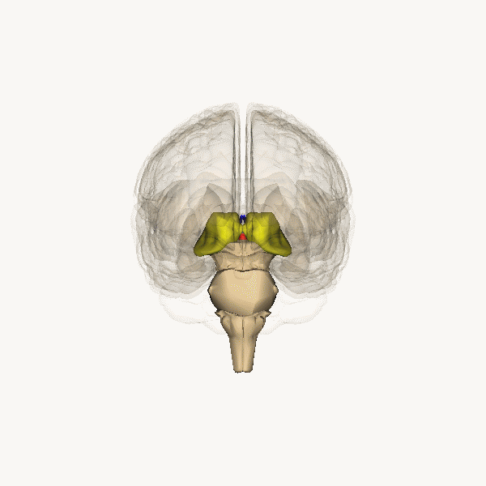{fig-align="center" height=800 .fragment}
:::

::: {.column}
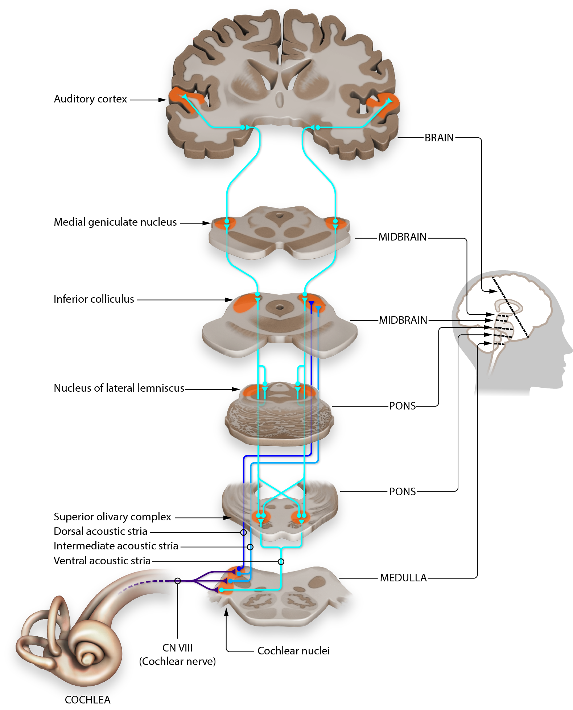{fig-align="center" height=800 .fragment}
:::

::::

::: {.fragment}
### But: small, deep brain structures are challenging to image.
:::

::: {.notes}
Across human behaviors, studying the brainstem is challenging.
- In vivo MRI limited by:
 - high resolution needed for small structures
 - decreased signal as voxels get smaller
 - decreased signal in brainstem
- Limited spatial information from EEG, MEG
- Some human histology studies (nuclei)
- Tracer studies (connections) only in animal models
:::

## Imaging the human subcortical auditory system {.smaller visibility="hidden"}

::: {.incremental}


::: {layout="[[1,1,1]]"  layout-valign="bottom"}
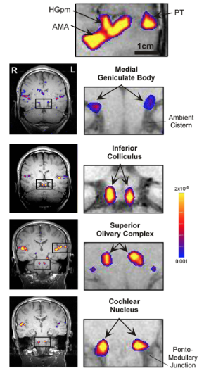{.fragment}

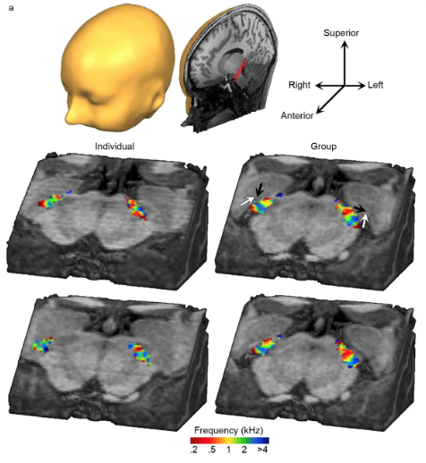{.fragment}

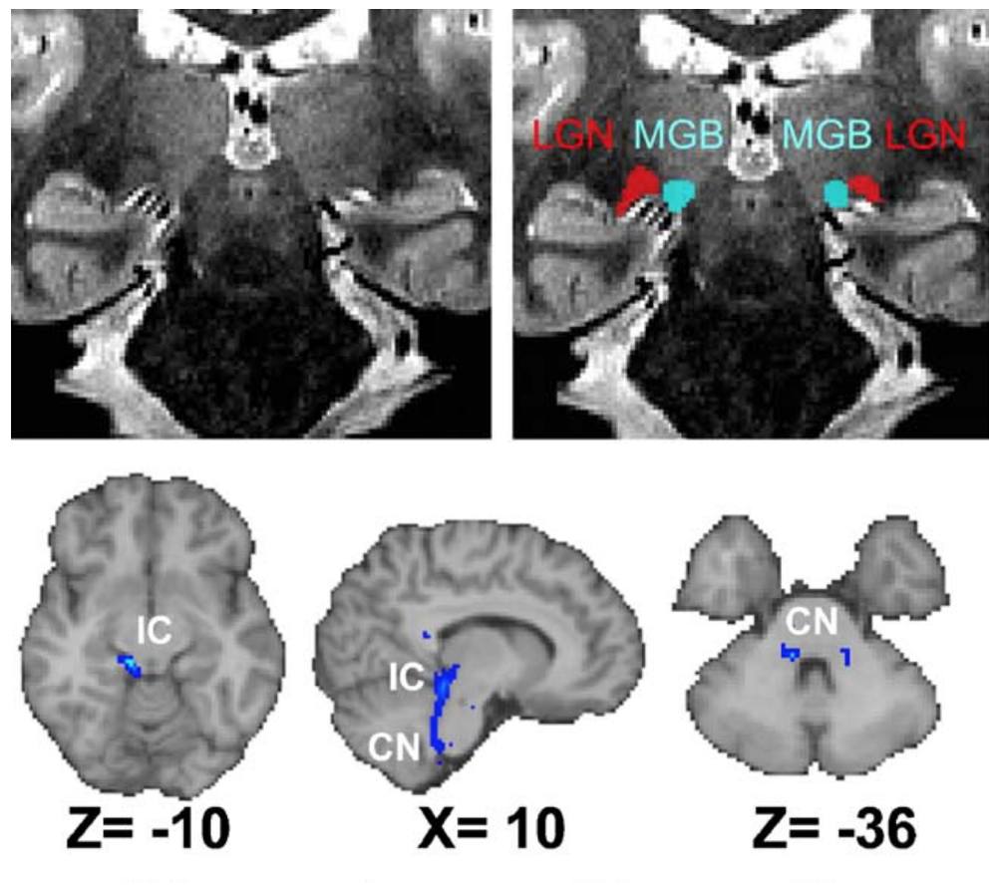{.fragment}
:::

::: 

::: {.notes}
Speaker notes go here.
:::

## Brainstem anatomy: Gold standard vs. standard practice {visibility="hidden"}

::: {layout-ncol=2}
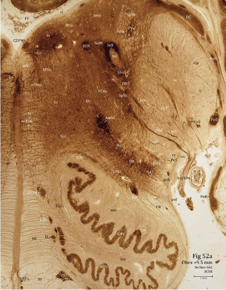{.fragment}

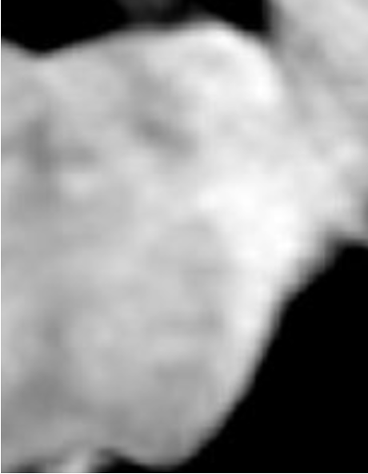{.fragment}

:::

## *Where* are the auditory structures in humans? {visibility="hidden"}

::: {.fragment}
### Post mortem localization 
- Human histology: BigBrain (20 µm)
- Post mortem brainstem MRI (small-bore 7 Tesla Bruker MRI)
  - T2*-weighted anatomy (50 µm)
  - Diffusion-weighted MRI (200 µm)
:::
::: {.fragment}
### In vivo localization 
- 7 Tesla functional MRI (Siemens Magnetom; 1.1 mm voxels)
  - 168 natural sounds (1 s each); sound > baseline contrast
  - Collected over 2 sessions
:::

## Post mortem anatomical localization {visibility="hidden"}

::: {layout-ncol=2}
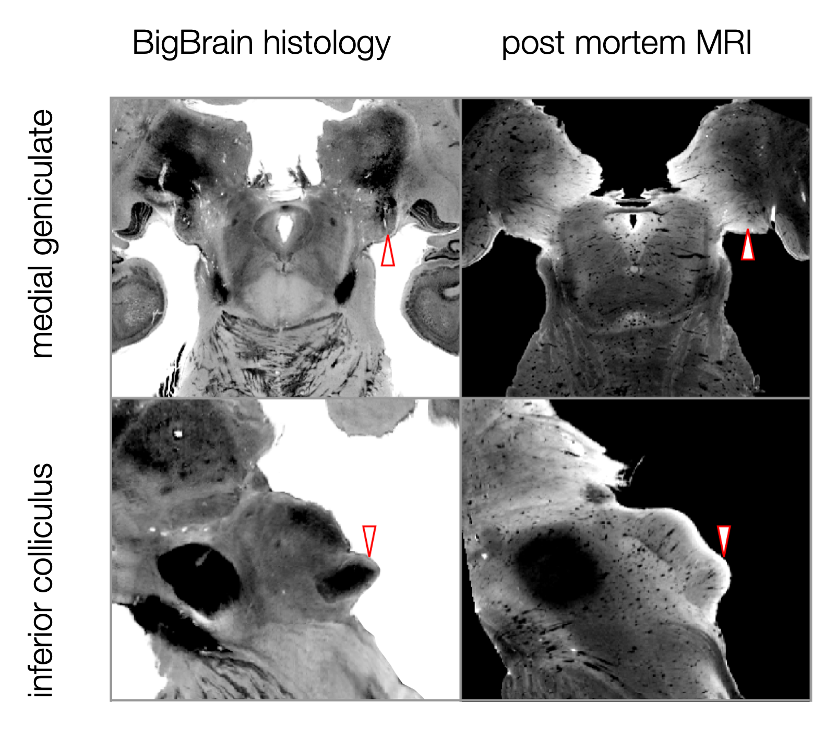{height="420" .fragment}

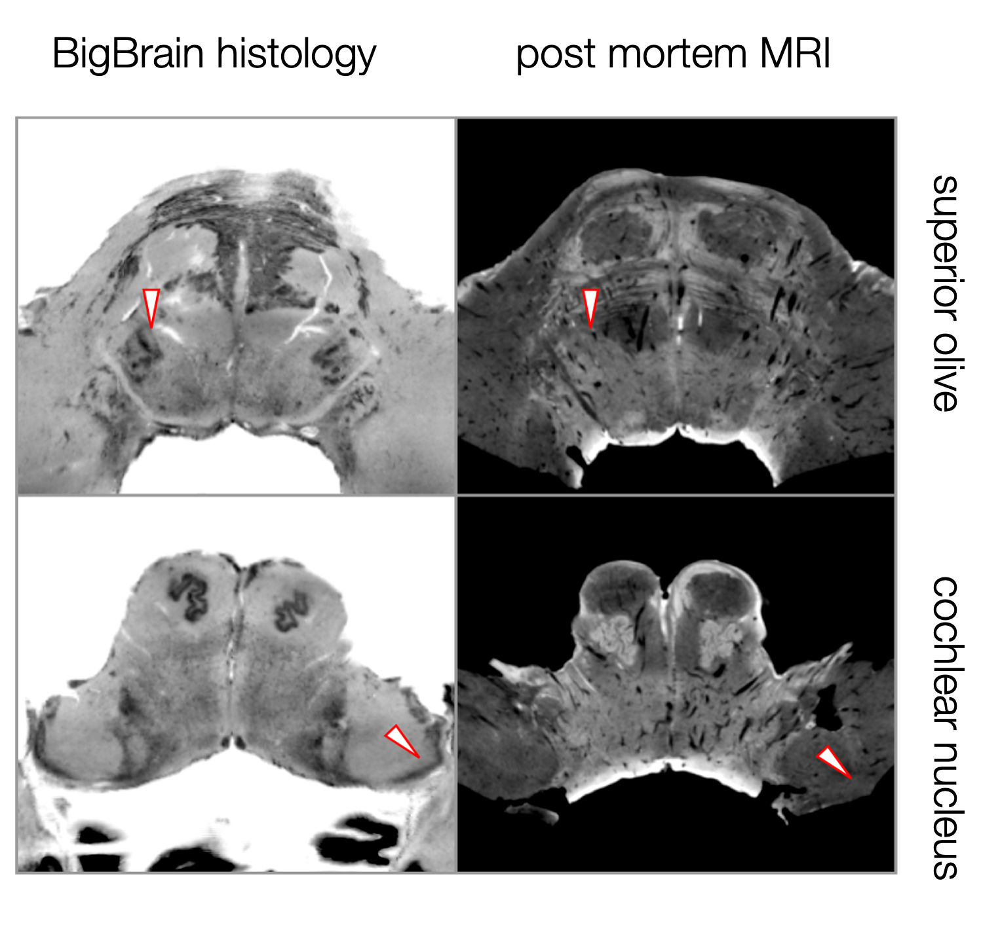{height="420" .fragment}

:::

::: aside
Sitek and Gulban et al. (2019 *eLife*)
:::

::: {.notes}
Speaker notes go here.
:::

## 3D subcortical atlases {visibility="hidden"}

::: {layout-ncol=2}
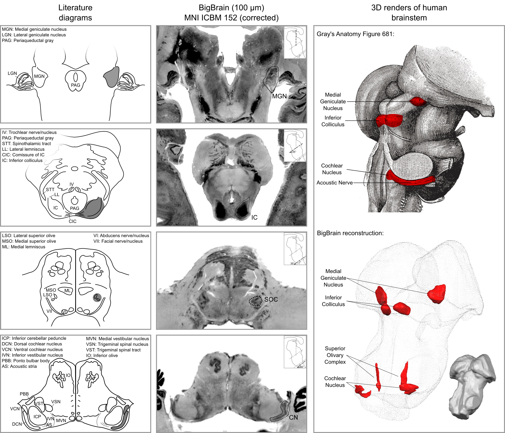{height="420" .fragment}

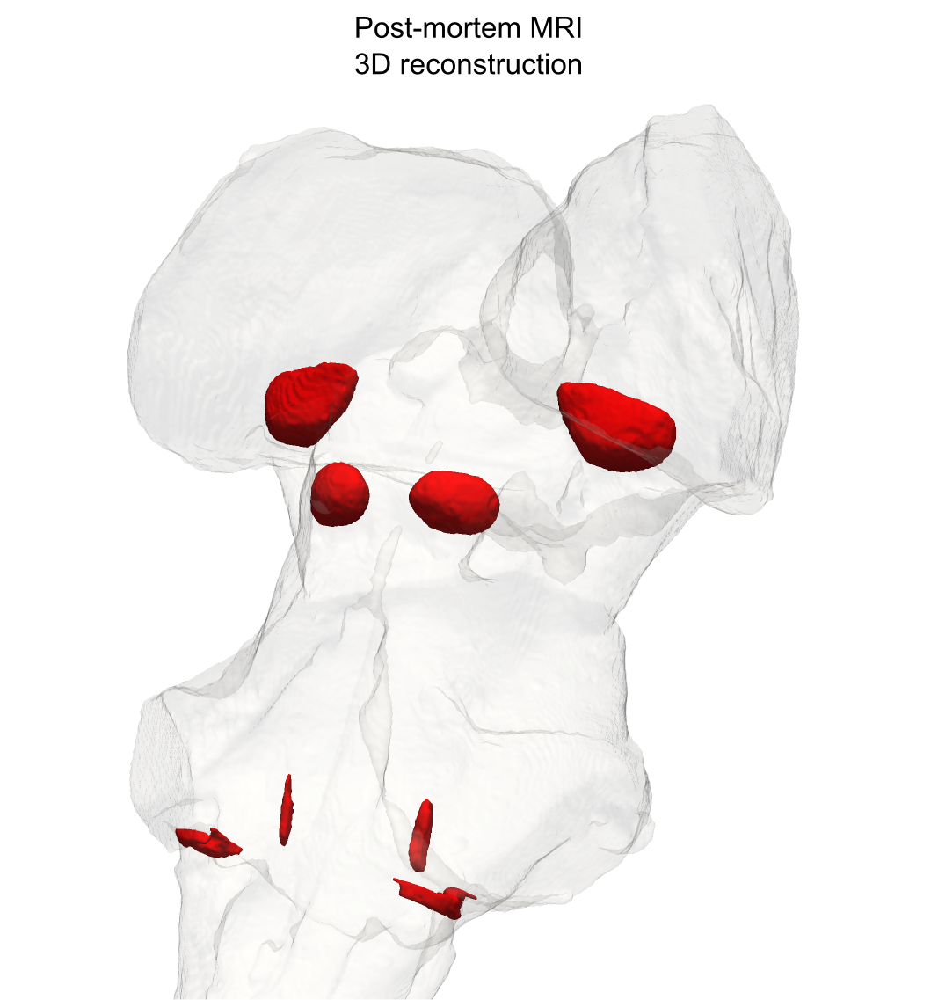{height="420" .fragment}

:::

{.absolute bottom=10 right=10 width="200" height="200"}

::: aside
Sitek and Gulban et al. (2019 *eLife*)
:::

::: {.notes}
Speaker notes go here.
:::

## In vivo functional MRI mapping {visibility="hidden"}
:::: {.columns}
::: {.column width="27%" .fragment}
### 7 Tesla functional MRI (1.1 mm voxels)
- 168 natural sounds (1 s each): speech, voice, nature, tools, music, animals and monkey calls
- Sound > baseline contrast
- 10 healthy participants
- 2 hours per session
- Collected over 2 sessions
:::

::: {.column width="73%" .fragment}
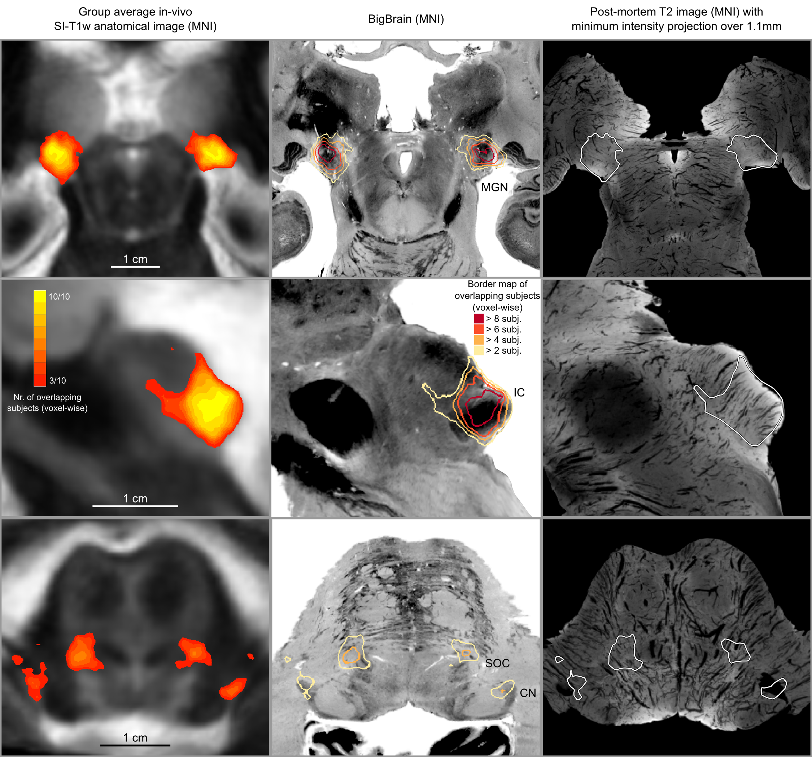{fig-align="center" height=900}
:::
::::
{.absolute bottom=10 right=10 width="200" height="200"}

::: aside
Sitek and Gulban et al. (2019 *eLife*)
:::

::: {.notes}
Participants listened to 168 natural sounds (1 s long) coming from seven categories (speech, voice, nature, tools, music, animals and monkey calls) presented in silent gaps in between the acquisition of functional volumes and were asked to press a button every time the same sound was repeated. The experimental paradigm followed a rapid-eventrelated design in which sounds were presented with a mean inter stimulus interval of four volumes (minimum three maximum five volumes). The two sessions were identical and each session consisted of twelve functional runs and across the 12 runs each sound was presented three times (i.e. each sounds was presented six times across the two sessions). The 168 sounds were divided in four sets of 42 sounds, each set was presented in three (non consecutive) runs. As a result, the 12 functional runs of each session formed four cross validation sets each one consisting of nine training runs and three testing runs (i.e. 126 training and 42 testing sounds). Note that the testing runs were non overlapping across the cross validations. Catch trials (i.e. sound repetitions) were added to each run, and were excluded from all analyses.
:::

## *Where* are the auditory structures: Three public atlases 

::: {.r-stack}


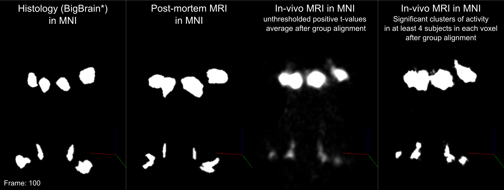{.fragment fig-align="center"}
:::

{.absolute bottom=10 right=10 width="200" height="200"}

::: aside
Sitek and Gulban et al. (2019 *eLife*)
:::

::: {.notes}
Speaker notes go here.
:::

# Connectivity of the human subcortical auditory system {visibility="hidden"}

::: {.notes}
Speaker notes go here.
:::

## Anatomical connectivity mapping {visibility="hidden"}

:::: {.columns  layout-valign="center"}

::: {.column .fragment}
### Diffusion-weighted MRI tractography
- Look at how MRI signal varies across directions of molecular motion 
- Since white matter constrains the motion of water molecules, we can infer orientation of white matter in each voxel
- Then traverse voxel-to-voxel to estimate pathways (*tractography*)
:::

::: {.column .fragment}
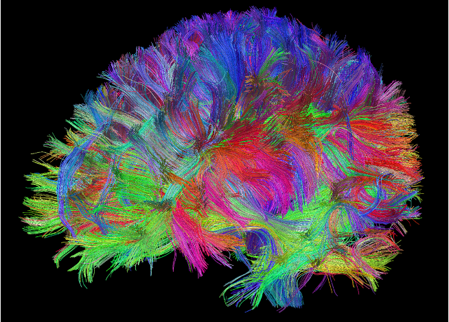{}
:::
::::

::: {.notes}
Speaker notes go here.
:::

## How are the auditory structures connected **anatomically**? {visibility="hidden"}

:::: {columns}
::: {.column .fragment}
#### Post mortem

:::

::: {.column .fragment}
#### In vivo


:::
::::

{.absolute bottom=10 right=10 width="200" height="200"}

::: aside
Sitek and Gulban et al. (2019 *eLife*); 
Sitek et al. (2022 *Frontiers Neuro*)
:::

::: {.notes}
{fig-align="center" height=777} 
{fig-align="center" height=777 .fragment}
:::

## How are the auditory structures connected **functionally**?{.smaller}

#### Extracting the *pathway* (partial correlations) from the *network* (simple correlations) {.fragment}


:::: {columns}

::: {.column width="30%"}
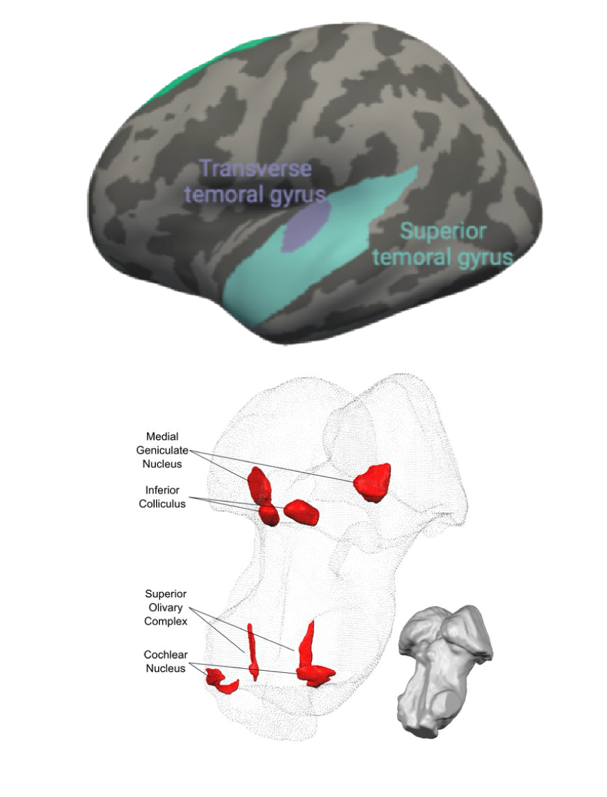{.fragment}
:::

::: {.column width="70%" }
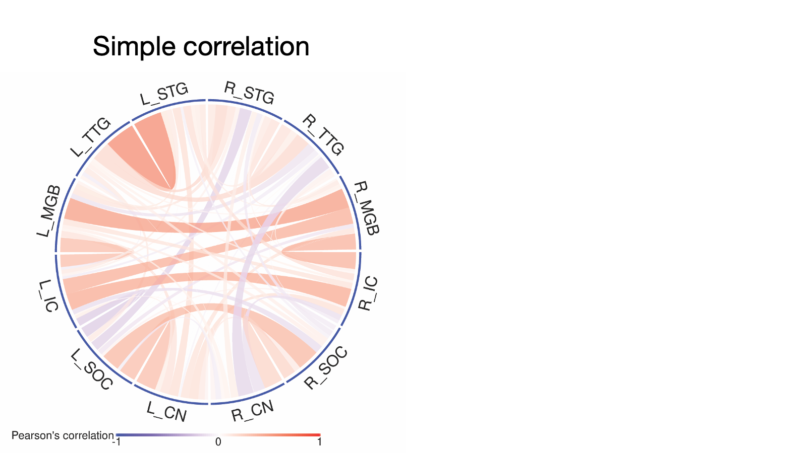{.fragment}

:::
::::

7T Human Connectome Project (106 participants) resting state **functional** MRI


{.absolute bottom=10 right=10 width="200" height="200"}

::: aside
Chandra* and Sitek* et al. (2024 *Imaging Neuro*)
:::

::: {.notes}
Speaker notes go here.
:::

## How are the auditory structures connected **functionally**?{.smaller visibility="uncounted"}

#### Extracting the *pathway* (partial correlations) from the *network* (simple correlations)

:::: {columns}

::: {.column width="30%"}

:::

::: {.column width="70%" }
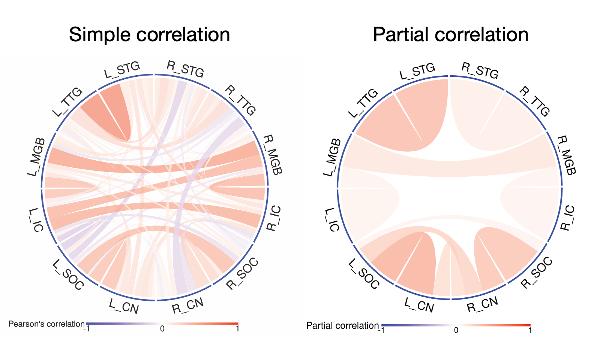

:::
::::

7T Human Connectome Project (106 participants) resting state **functional** MRI


{.absolute bottom=10 right=10 width="200" height="200"}

::: aside
Chandra* and Sitek* et al. (2024 *Imaging Neuro*)
:::

::: {.notes}
Speaker notes go here.
:::

## Seeing the auditory brainstem on everyday MRI scanners

{.absolute bottom=10 right=10 width="200" height="200"}

:::: {.columns}

::: {.column width="55%"}
::: {.fragment}
#### The problem
- The auditory brainstem is small and deep, so its MRI signal is weak
- Specialized 7T scanners help, but most hospitals and research centers have 3T
:::

::: {.fragment}
#### The fix: multi-echo fMRI
- Standard fMRI uses one "exposure" setting, tuned for the cortex
- Multi-echo captures several exposures and combines them, **like HDR on your phone camera**
- Each brain region gets the exposure that suits it, and noise (breathing, head motion) is easier to remove
:::

::: {.fragment}
**Study:** 14 adults listened to 10 minutes of pop music; 3 returned for many repeat sessions
:::
:::

::: {.column width="45%"}
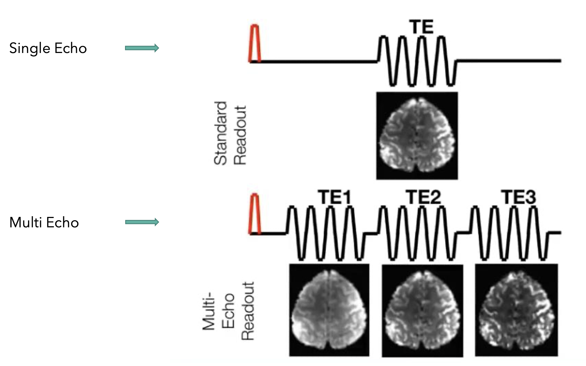{fig-align="center"}
:::

::::

::: aside
Medina et al. (2026 *Hearing Research*)
:::

::: {.notes}
So far, everything I've shown used 7 Tesla MRI. 7T is becoming more common (Siemens Terra is FDA-approved), but 3T is what most clinics have.

- Multi-echo fMRI acquisition (UMinn CMRR)
  - Echo times = 13.40/39.5/65.6 ms
  - Repetition time = 2.2 s
  - Multiband factor = 2
  - Voxel size = 1.731×1.731×4 mm^3^
  - Whole-brain coverage (44 slices, FOV=180mm)
- Multi-echo optimal combination + ICA noise removal (`tedana`)
:::

## Multi-echo finds more auditory activity across the group

{.absolute bottom=10 right=10 width="200" height="200"}

:::: {.columns}
::: {.column}
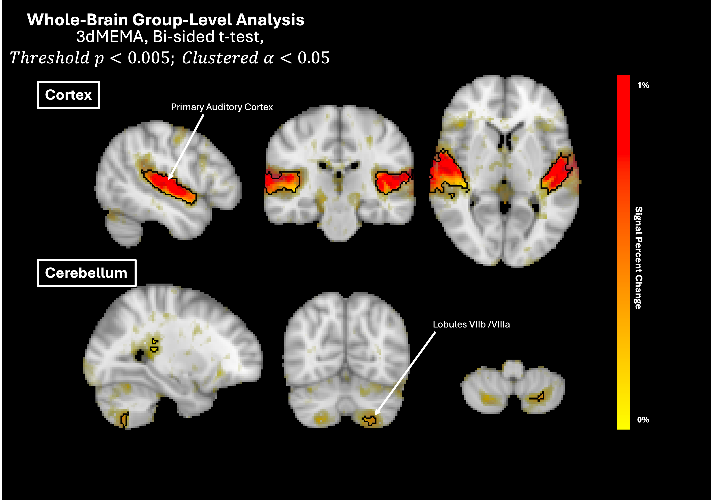{.fragment fig-align="center"}
:::
::: {.column}
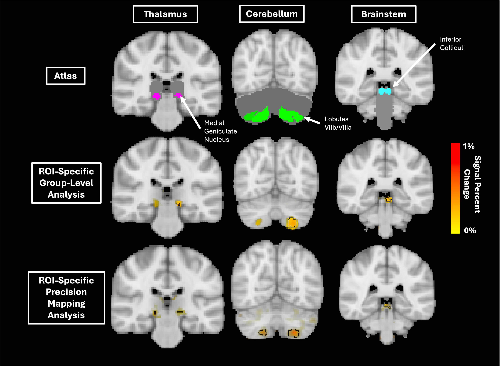{.fragment fig-align="center"}
:::
::::

::: {.fragment}
#### Stronger responses in auditory cortex *and* brainstem, on a standard 3T scanner
:::

::: aside
Medina et al. (2026 *Hearing Research*)
:::

::: {.notes}
:::

## Mapping one person's auditory brainstem in less scan time

{.absolute bottom=10 right=10 width="200" height="200"}

:::: {.columns}

::: {.column width="55%" .fragment}
#### Multi-echo needs less scan time to find the auditory brainstem
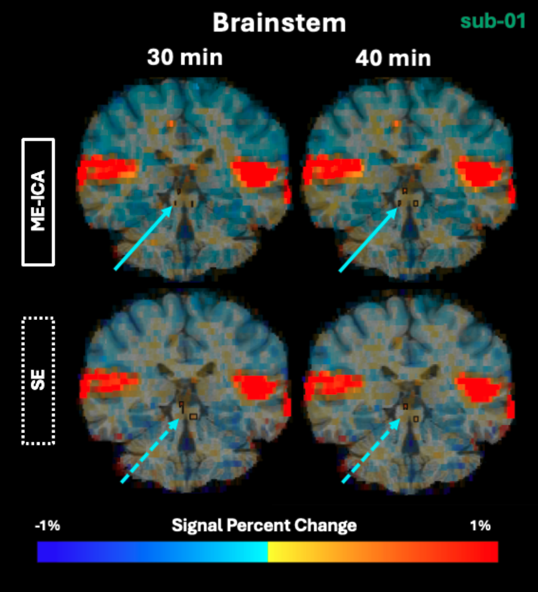{fig-align="center" height="650"}
:::

::: {.column width="45%" .fragment}
#### Stronger brainstem responses in each individual
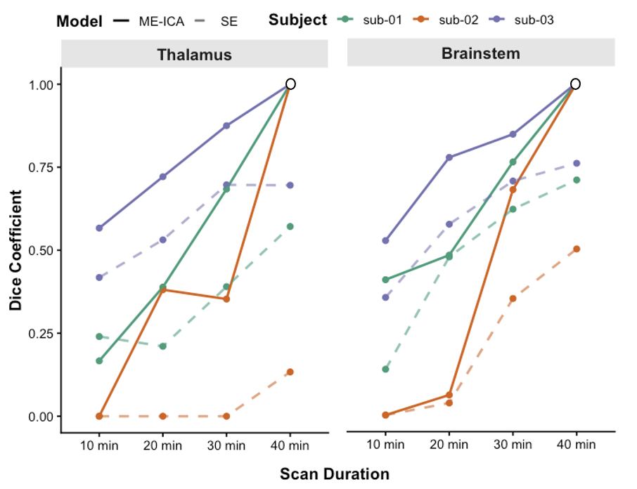{fig-align="center"}
:::

::::

::: aside
Medina et al. (2026 *Hearing Research*); Medina et al. (2026 *bioRxiv*, in review)
:::

::: {.notes}
**Why it matters:** individual maps are the first step toward clinical use, for example in hearing loss or before cochlear implants. Companion paper: how to run valid statistics on one person's repeated scans (Medina et al., 2026 *bioRxiv*)
:::

# 

# Auditory–motor interactions across the auditory pathway

::: {.notes}
So far I've focused on the basics: where are human auditory structures, and how are they connected. 
Ultimately, we want to *use* these approaches to learn more about the *function* of the human brain 
*in action*. 
:::

## Human speech and auditory feedback processing

:::: {.columns}

::: {.column .fragment}
#### Suppressed cortical response to own voice while speaking (Houde & Jordan 2002)

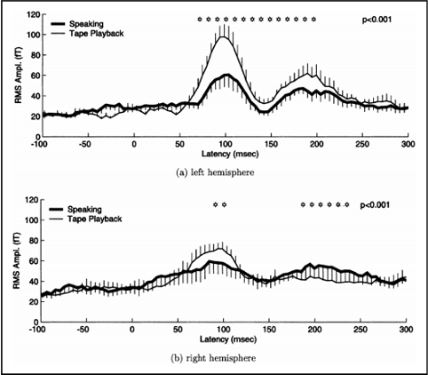{fig-align="center" height="700"}

:::

::: {.column .fragment}
#### Less suppression when our own speech is *variable* (Sitek et al. 2013)

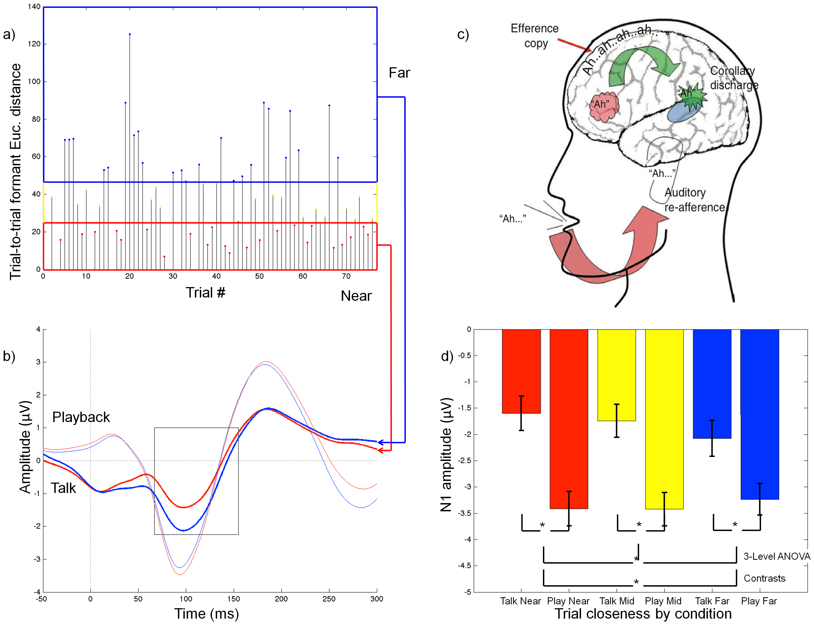{fig-align="center" height="700"}

:::
::::


::: aside
This work is actively supported by R21-DC022906 (PI: Sitek).
:::

::: {.notes}
:::

## Auditory feedback processing in animals

:::: {.columns}

::: {.column .fragment}
#### Overall suppression (but some excitation) in marmoset auditory cortex^[Eliades & Wang (2005)]

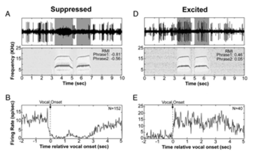{height="500" fig-align="center"}
:::

::: {.column .fragment}
#### Decreased auditory brainstem response to own licking sound in mouse^[Singla et al. (2017)]
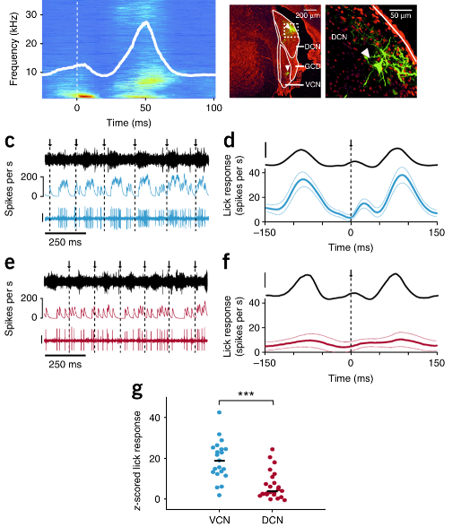{height="800" fig-align="center"}
:::

::::

::: {.notes}
Speaker notes go here.
:::

## Studying the human subcortical auditory system with EEG

#### The scalp-recorded frequency-following response (FFR) shows the fidelity of early incoming sound encoding
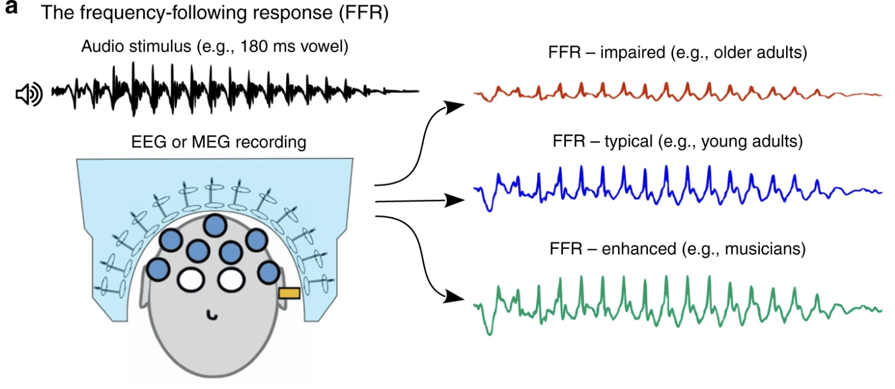{fig-align="center" .fragment}

::: aside
Coffey et al. (2018)
:::

::: {.notes}
:::

## *Where* are motor signals integrated? Subcortically? 

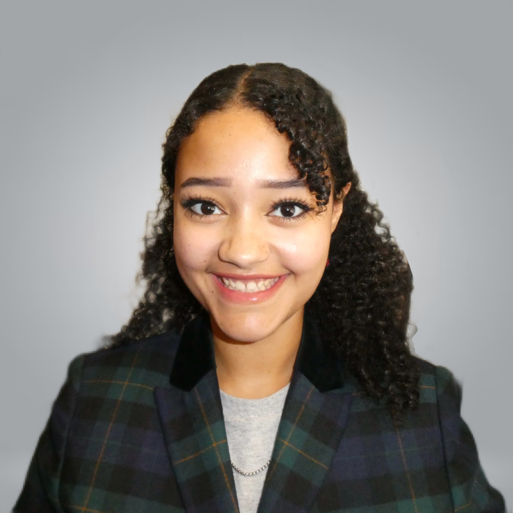{.absolute bottom=10 right=10 width="200" height="200"}
{.absolute bottom=10 right=220 width="200" height="200"}

:::: {.columns}

::: {.column width="45%" .fragment}
- If integration is **subcortical**:
  - Expect to see **FFR** differences between *self-generated* and *passive* sound
- Recorded FFRs to /da/ stimulus
  - *Active* condition: press a button to generate a sound
  - *Passive* condition: passive presentation of the sound
  - *Motor* condition: button press alone, to subtract out motor activity
- Collected data from 33 normal-hearing adults
:::

::: {.column width="55%" .fragment}
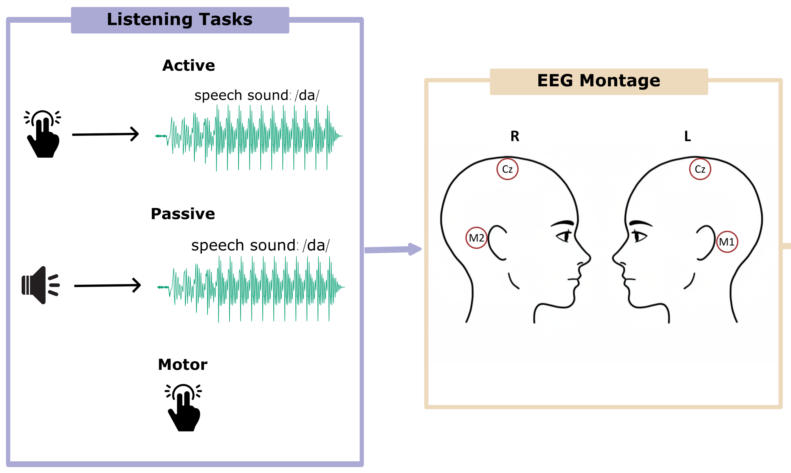{fig-align="center" height="620"}
:::
::::

::: aside
Raiff\* & Butler\* et al. (2026 *bioRxiv*; in review)
:::

::: {.notes}
:::

## Active and passive evoked responses

{.absolute bottom=10 right=10 width="200" height="200"}
{.absolute bottom=10 right=220 width="200" height="200"}

:::: {.columns}

::: {.column .fragment}
#### Early encoding in the FFR: no difference
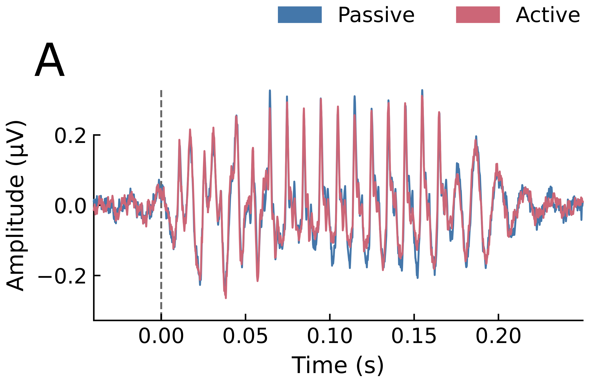{fig-align="center" width="95%"}
:::

::: {.column .fragment}
#### Cortical response: suppressed for self-generated sound
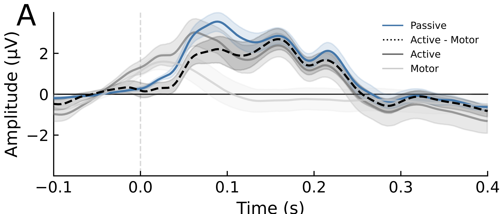{fig-align="center" width="100%"}
:::
::::

::: aside
Raiff\* & Butler\* et al. (2026 *bioRxiv*; in review)
:::

::: {.notes}
FFR spectrograms don't vary between conditions; neither do power or latency-to-first-peak

All of which *do* vary in cortical responses

Cortical: dashed line = Active minus Motor-only (button press with no sound). It stays below Passive, so the suppression isn't just the button press.
:::

## Active and passive time–frequency responses {visibility="hidden"}

{.absolute bottom=10 right=10 width="200" height="200"}
{.absolute bottom=10 right=220 width="200" height="200"}


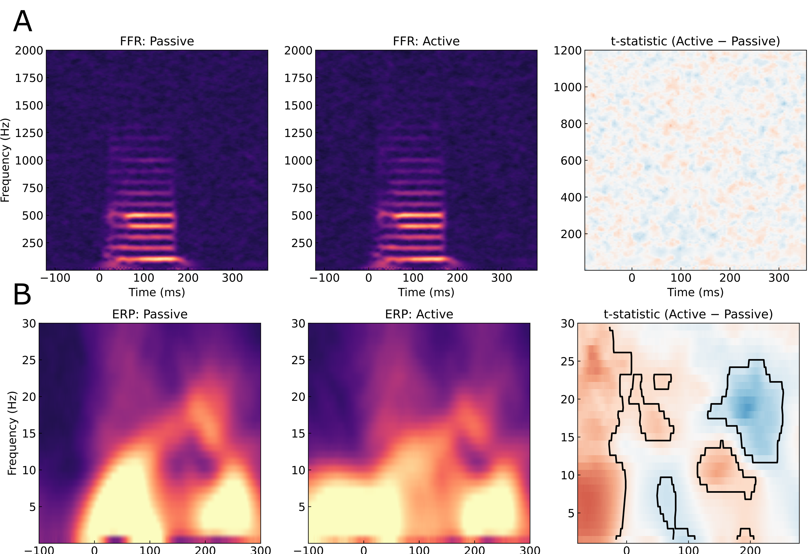{fig-align="center" height="780"}

::: aside
Raiff\* & Butler\* et al. (2026 *bioRxiv*; in review)
:::

::: {.notes}
:::

## Active and passive FFR pitch tracking and amplitude {visibility="hidden"}

{.absolute bottom=10 right=10 width="200" height="200"}
{.absolute bottom=10 right=220 width="200" height="200"}

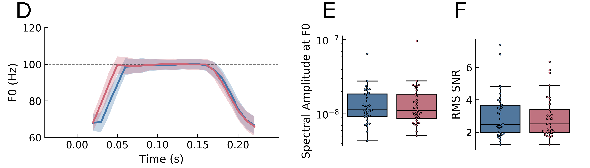{.fragment fig-align="center" width="100%"}

::: aside
Raiff\* & Butler\* et al. (2026 *bioRxiv*; in review)
:::

::: {.notes}
:::

## *Where* are motor signals integrated? Subcortically?

{.absolute bottom=10 right=10 width="200" height="200"}
{.absolute bottom=10 right=220 width="200" height="200"}

#### Early auditory frequency-following response (FFR) shows the same sound encoding when a sound is self-generated or passively presented

::: {.incremental}
- No **early auditory FFR** differences, despite **cortical** suppression
- *Motor signals unlikely to attenuate earliest central auditory signals*
- Next steps: 
  - **Source localization** of FFR generators (ECR R21 project)
  - **Cortical layer-specific** feedback localization with 7T fMRI (R21, at UT Dallas; Pitt pilot data)
:::

::: aside
Raiff\* & Butler\* et al. (2026 *bioRxiv*; in review)
:::

::: {.notes}
If integration is subcortical, would expect to see FFR differences between self-generated vs. passive sound
:::

## Digging deeper into auditory–motor interactions (ongoing)

{.absolute bottom=10 right=10 width="200" height="200"}

:::: {.columns}

::: {.column}
#### Is auditory processing modulated by **expectation** of self-generated sound?
- 64-channel EEG enables **source localization** of FFR generators
- Task modulation:
  - 2 stimulus *f0*s: 100 Hz and 250 Hz
  - 2 expectation conditions (80%/20%)
  - Active and passive blocks (and motor-only control)
- 36 participants collected with 2 sessions
:::

::: {.column}

:::

::::

::: aside
Raiff, ..., Sitek (in prep.; ARO 2027)
:::

::: {.notes}
EAM2 is led by Laura Raiff.
:::

# Open tools for the frequency-following response: FFRPrep

::: {.notes}
Open science: BIDS-formatted data + an open pipeline means any lab can reproduce the analysis. That matters for comparing FFRs across labs and, eventually, clinics.
:::

## FFRPrep: an open, standardized pipeline for FFR data

{.absolute bottom=10 right=10 width="200" height="200"}
{.absolute bottom=10 right=220 width="200" height="200"}

::: {.fragment}
FFR studies use **inconsistent analyses, file formats, and data sharing**, which makes results hard to compare across labs (or clinics)
:::

::: {.fragment}
```{=html}
<div style="display:flex; gap:14px; margin:20px 0;"><div style="flex:1; background:#f1eef6; border-radius:12px; padding:18px 22px;"><div style="color:#665086; font-weight:700;">1. Validate</div><div style="font-size:0.75em; margin-top:6px;">Checks the dataset follows the BIDS standard</div></div><div style="align-self:center; font-size:1.6em; color:#665086;">&rarr;</div><div style="flex:1; background:#f1eef6; border-radius:12px; padding:18px 22px;"><div style="color:#665086; font-weight:700;">2. Preprocess</div><div style="font-size:0.75em; margin-top:6px;">Filter, re-reference, epoch, reject artifacts</div></div><div style="align-self:center; font-size:1.6em; color:#665086;">&rarr;</div><div style="flex:1; background:#f1eef6; border-radius:12px; padding:18px 22px;"><div style="color:#665086; font-weight:700;">3. Analyze</div><div style="font-size:0.75em; margin-top:6px;">Evoked responses, spectra, pitch tracking, SNR</div></div><div style="align-self:center; font-size:1.6em; color:#665086;">&rarr;</div><div style="flex:1; background:#f1eef6; border-radius:12px; padding:18px 22px;"><div style="color:#665086; font-weight:700;">4. Report</div><div style="font-size:0.75em; margin-top:6px;">Automatic HTML report for every participant</div></div></div>
```

:::

:::: {.columns .fragment}
::: {.column width="45%"}
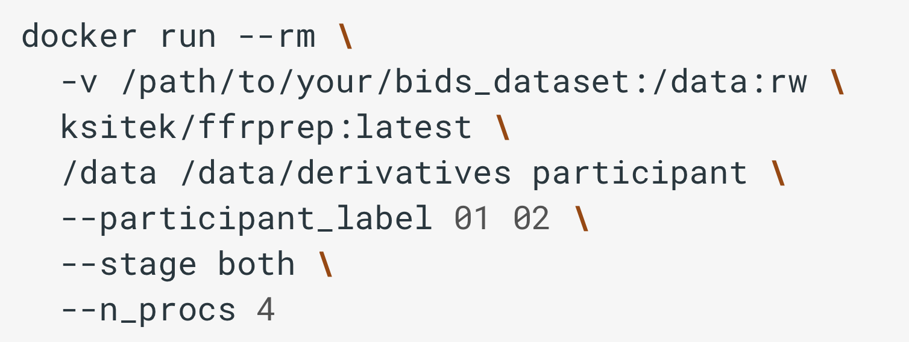{fig-align="center" width="95%"}
:::
::: {.column width="55%"}
- **One command** runs the whole pipeline
- Containerized and versioned, so results are reproducible
- Runs on a laptop or scales across a computing cluster
:::
::::

::: aside
Sitek, Chen & Herholz (OHBM 2026); [sitek.github.io/ffrprep](https://sitek.github.io/ffrprep)
:::

::: {.notes}
Each stage is a modular Nipype workflow. Parallelizes across task/run within a subject (--n_procs); for clusters, one call per subject (e.g., slurm job arrays).

Preprocessing: load BIDS M/EEG with pybids + MNE-BIDS; reference (average, Cz, or M1/M2); filter while preserving the FFR; epoch from BIDS events, with amplitude-based rejection.

Analysis: combined evoked, per-trial-type evokeds (e.g., positive/negative polarity), and difference evokeds.

Future: multi-channel validation, more denoising/artifact options, single-trial classification, more test datasets.

Max Chen (Cog Sci/Comp Sci undergrad) and Peer Herholz.
:::

## Every participant gets a transparent report: preprocessing

{.absolute bottom=10 right=10 width="200" height="200"}
{.absolute bottom=10 right=220 width="200" height="200"}

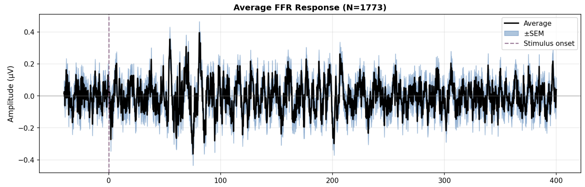{fig-align="center" height="290" .fragment}

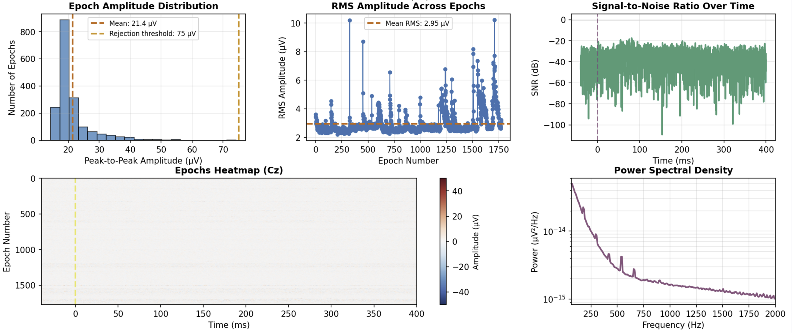{fig-align="center" height="440" .fragment}

::: aside
Sitek, Chen & Herholz (OHBM 2026); [sitek.github.io/ffrprep](https://sitek.github.io/ffrprep)
:::

::: {.notes}
Top: the participant's average FFR (here, 1773 epochs) with SEM and stimulus onset.

Bottom: automatic quality checks for every epoch: peak-to-peak amplitude distribution with the rejection threshold, RMS across epochs (spots noisy stretches), SNR over time, an epoch-by-epoch heatmap, and the power spectrum (line noise, etc.).

The point: anyone can see exactly what happened to the data before analysis.
:::

## Every participant gets a transparent report: analysis

{.absolute bottom=10 right=10 width="200" height="200"}
{.absolute bottom=10 right=220 width="200" height="200"}

:::: {.columns}
::: {.column width="55%"}
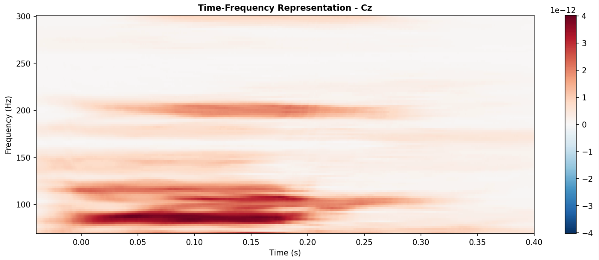{fig-align="center" width="100%" .fragment}

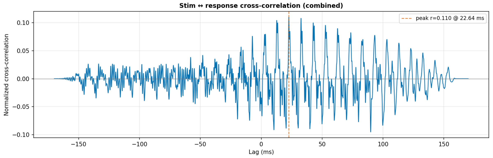{fig-align="center" width="100%" .fragment}
:::
::: {.column width="45%"}
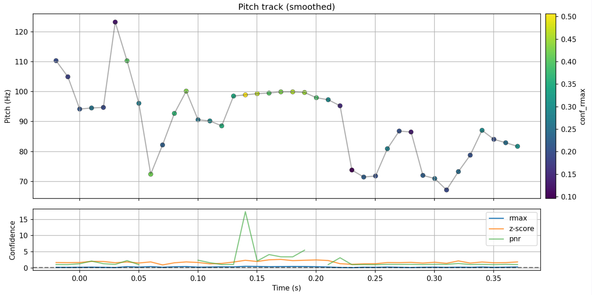{fig-align="center" width="100%" .fragment}

::: {.fragment}
#### Try FFRPrep and let us know what you think!
:::
:::
::::

::: aside
Sitek, Chen & Herholz (OHBM 2026); [sitek.github.io/ffrprep](https://sitek.github.io/ffrprep)
:::

::: {.notes}
Time–frequency: energy at the stimulus f0 (~100 Hz) and harmonics during the sound.

Stimulus–response cross-correlation: how faithfully the brain response follows the stimulus waveform, and at what lag (here, peak at ~23 ms, consistent with subcortical generators).

Pitch tracking: f0 extracted from the response over time, colored by confidence; tracks the 100 Hz stimulus f0 during the steady-state portion.

Each report also includes waveforms, spectra, autocorrelation, phase consistency, and scalar metrics (RMS SNR, spectral power), for each condition and their differences.

Musicianship EEG Dataset (Whiteford et al., 2025, Nature Communications): 296 participants, 6 sites; we converted it to BIDS and shared it on Zenodo (https://doi.org/10.5281/zenodo.22967621). License: CC BY-NC 4.0.

Same /da/ syllable as the auditory–motor studies we just saw, so FFRPrep applies directly to our own data.
:::

## FFRPrep: Group validation on a large multi-site FFR dataset {visibility="hidden"}

{.absolute bottom=10 right=10 width="200" height="200"}
{.absolute bottom=10 right=220 width="200" height="200"}

:::: {.columns}

::: {.column}
::: {.incremental}
- **Musicianship EEG Dataset**: 296 participants across 6 sites (74 musicians, 88 non-musicians); Cz FFRs to /da/, 6000 trials each, both polarities (Whiteford et al., 2025)
- Converted to **BIDS** and shared openly ([Zenodo](https://doi.org/10.5281/zenodo.22967621))
- **TODO**: validation result (e.g., FFRPrep reproduces published group FFRs and site/musicianship effects)
:::
:::

::: {.column}
*TODO: group FFR waveform / spectrum figure from FFRPrep*
:::

::::

::: aside
Chen, Herholz, ..., Sitek (in prep.) <!-- TODO: confirm citation -->; Whiteford et al. (2025) *Nature Communications* 16, 7152; Musicianship EEG Dataset (BIDS version), Zenodo (2026)
:::

::: {.notes}
Same /da/ syllable as the auditory–motor studies we just saw, so FFRPrep applies directly to our own data.

Dataset license: CC BY-NC 4.0.
:::

## Preprocessing report: Overview {visibility="hidden"}

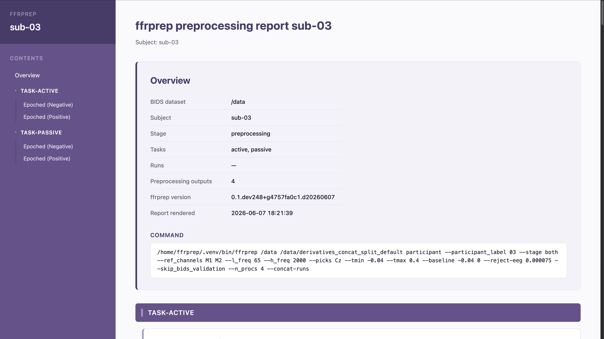{fig-align="center" height="900"}

## Preprocessing report: Epoching {visibility="hidden"}

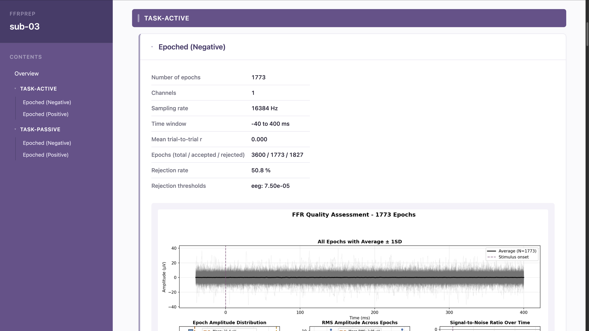{fig-align="center" height="900"}

## Preprocessing report: Quality assessment {visibility="hidden"}

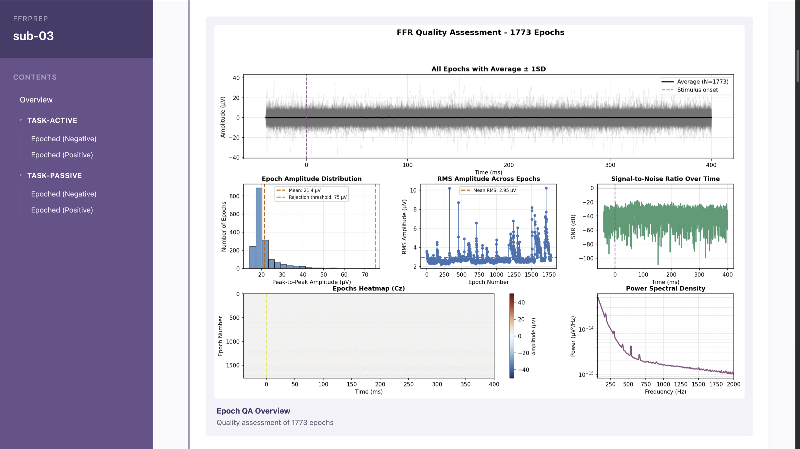{fig-align="center" height="900"}

## Preprocessing report: Average responses {visibility="hidden"}

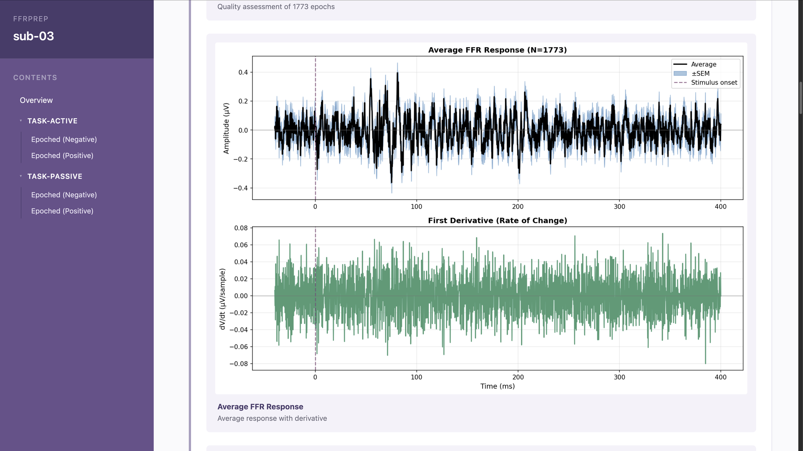{fig-align="center" height="900"}

## Preprocessing report: Drift check {visibility="hidden"}

{fig-align="center" height="900"}

## Analysis report: Overview {visibility="hidden"}

{fig-align="center" height="900"}

## Analysis report: Evoked response {visibility="hidden"}

{fig-align="center" height="900"}

## Analysis report: Spectral information {visibility="hidden"}

{fig-align="center" height="900"}

## Analysis report: Pitch tracking {visibility="hidden"}

{fig-align="center" height="900"}

## Analysis report: Phase consistency {visibility="hidden"}

{fig-align="center" height="900"}

## Analysis report: Stimulus–response correlation {visibility="hidden"}

{fig-align="center" height="900"}

# 

# Auditory categorization in the human brain

::: {.notes}
Speaker notes go here.
:::

## How do we learn new sensory categories?

::: {layout="[70,30]"}

::: {.incremental}
- **Dorsal striatum** contributes to learning new categories thanks to its projections from **distributed cortical networks** that perform:
  - motor planning
  - **task-relevant sensory processing**
  - **feedback processing**
  - decision-making
- Dorsal striatum involved in auditory category learning tasks using fMRI (Feng et al., 2019; Lim et al., 2019; Yi et al., 2016)
  - What **anatomical pathways** connect the human auditory system to the striatum?
  - How do *subdivisions* of dorsal striatum **functionally contribute** to category learning?
:::

{fig-align="center"}
:::

::: aside
This work is actively supported by K01-DC019421 (PI: Sitek)
:::


::: {.notes}
Speaker notes go here.
:::

## Auditory-striatal pathways in non-human primates  {visibility="hidden"}

{fig-align="center" height="800" .fragment}

::: aside
:::

::: {.notes}
Speaker notes go here.
:::

## Auditory-striatal pathways in the human brain  {visibility="hidden"}

{fig-align="center" height="800" .fragment}

::: aside
Human Connectome Project 7T diffusion-weighted MRI dataset (n = 97)
:::

::: {.notes}
Speaker notes go here.
:::

## Similar connectivity patterns in humans and macaques

::: {.incremental}

::: {layout="[30,70]"}

{fig-align="center" height="600" .fragment}

{fig-align="center" height="600" .fragment}

:::
:::

::: aside
:::

::: {.notes}
Speaker notes go here.
:::

## Each cortical network has its own striatal connectivity profile

{fig-align="center" height="560" .fragment}

::: {.incremental}
- **Auditory** and **visual** cortices connect most strongly with the **posterior putamen** – but auditory is more hierarchical
- **Prefrontal** cortex connects broadly across caudate and anterior putamen
- **Motor** cortex favors posterior putamen and posterior caudate
:::

::: aside
Sitek et al. (in revision); Human Connectome Project 7T diffusion-weighted MRI (n = 97)
:::

::: {.notes}
Diffusion tractography from each cortical network to four dorsal striatal subdivisions (aCAU, pCAU, aPUT, pPUT), both hemispheres. Note the log-scale y-axis: differences between subdivisions are often an order of magnitude.

Visual cortex follows the same posterior-putamen pattern as auditory.
:::

## How do humans learn new sound categories? {.smaller}

:::: {.columns}

::: {.column width="50%"}
::: {.incremental}
- Auditory category learning task with Mandarin tone stimuli (Yi 2016; Reetzke 2018; Feng 2019; …)
- 12 **non**-Mandarin speakers and 13 native Mandarin speakers (18–30 years old)
:::

{fig-align="center" height="550" .fragment}
:::

::: {.column width="50%"}
::: {.incremental}
- 7 Tesla high resolution functional MRI (1.5 mm isotropic voxels) 
- Each trial: hear a tone → choose a category → get feedback
:::

{fig-align="center" width="95%" .fragment}
:::

::::

::: aside
:::
::: {.notes}
Speaker notes go here.
:::

## Successful learning of new auditory categories in MRI {visibility="hidden"}

{height="900" .fragment}

::: aside
Sitek et al. (in revision)
:::
::: {.notes}
Speaker notes go here.
:::

## Successful learning of new auditory categories in MRI {visibility="hidden"}

{height="900"}

::: aside
Sitek et al. (in revision)
:::
::: {.notes}
Speaker notes go here.
:::


## Auditory fMRI responses to sound presentation {visibility="hidden"}

{height="750" .fragment}


::: aside
Sitek et al. (in revision)
:::

::: {.notes}
Sound responses: everything significant except for ParsTri
:::

## Auditory fMRI responses to sound presentation {visibility="hidden"}

::: {layout-ncol=2 layout-valign="bottom"}
{height="700" .fragment}

{height="700" .fragment}

:::

::: aside
Sitek et al. (in revision)
:::

::: {.notes}
Sound responses: everything significant except for ParsTri
:::

## Are there *representations* of task-relevant auditory categories? {visibility="hidden"}

:::: {.columns}

::: {.column width="20%"  .fragment}
{height="800" fig-align="center"}
:::
::: {.column width="45%"  .fragment}
{height="850" fig-align="center"}
:::
::: {.column width="35%" .fragment}

#### Cortical RSA
  - Stronger Tone than Talker representation overall *and for each region*
  - Significantly stronger Tone representation in **STGp** vs. HG or PT

#### Striatum RSA
  - Stronger Tone than Talker representation overall (t = = 2.93, p = .014)
  - No significant difference between subdivisions

:::
::::

::: aside
Sitek et al. (in revision)
:::

::: {.notes}
Sound responses: everything significant except for ParsTri
:::

## fMRI responses to feedback ("correct" vs. "wrong") {visibility="hidden"}

:::: {.columns}
::: {.column width="50%"  .fragment}
{fig-align="center"}
:::
::: {.column width="50%"  .fragment}
{fig-align="center"}
:::
::::

:::: {.fragment}
#### Striatum feedback responses 
  - All regions showed positive responses in *early* learning stage
  - But only **anterior putamen** *maintained* positive responses across all runs
  - Only **anterior caudate** *significantly decreased* responses from early to final learning stages
:::

::: aside
Sitek et al. (in revision)
:::

::: {.notes}
 - Sound responses: everything significant except for ParsTri
 - Stronger responses *overall* in early vs. final learning stages (runs)

:::

## Same sounds, different listeners: one group learns, one already knows

:::: {.columns}

::: {.column width="40%"}
::: {.incremental}
- 6 runs, grouped into *early*, *middle*, and *final* learning stages
- **Learners** (non-Mandarin speakers) and **native Mandarin multilinguallisteners** hear the same sounds and do the same task, but natives have nothing to learn
:::
:::

::: {.column width="60%" .fragment}
{fig-align="center" height="800"}
:::

::::

::: aside
Group × run *F*(5, 115) = 19.1, *p* < .001
:::

::: {.notes}
Natives are the control for everything except learning: same sounds, same responses, same feedback, but nothing to learn.

Learners rise from .38 to .82 (t(11) = 6.68). Natives are at ceiling: .95 in run 1, then ~.98.

If asked whether natives improved: small gain from run 1 to 2 (p = .041). That's getting used to the task, not learning the categories.
:::

## Learning reshapes the caudate's response to feedback

:::: {.columns}

::: {.column width="50%"}
{fig-align="center" width="100%"}

::: {.fragment}
- Learners' anterior caudate starts *above* natives' and converges by the final stage
:::
:::

::: {.column width="50%" .fragment}
{fig-align="center" height="650"}
:::

::::

::: {.fragment}
#### As learners learn, the anterior caudate's feedback response falls *relative to* the anterior putamen. Natives show no such shift.
:::


::: {.notes}
Within learners, aCAU's response to correct vs. wrong feedback declines with learning. Comparing groups requires correct feedback alone, because natives rarely make errors. On that contrast, the caudate-relative-to-putamen shift separates the groups.

Stage-by-stage gap (learners − natives, aCAU): +0.30, +0.15, −0.11. Present as convergence; no formal test.

Be clear: it's a *relative* difference. None of the four separate trends (aCAU and aPUT in each group) is significant, and the aCAU-only group test isn't either (p = .13).

Natives "flat": their aCAU trend is equivalent to zero (TOST q = .024), so "flat" is a tested claim, not a missing effect.

 (permutation *p* = .018; holds when any one participant is dropped)

:::

## Learners treat the sounds differently: frontal deactivation and weaker auditory responses

::: {.incremental}
- Both groups' auditory cortex and putamen respond to the tones
- But learners **deactivate medial frontal cortex** during sounds, and natives' **posterior STG** responds more strongly
:::

:::: {.columns}

::: {.column width="50%" .fragment}
#### Medial frontal cortex: lower in learners
::: {layout="[[64,36]]" layout-valign="center"}


:::
:::

::: {.column width="50%" .fragment}
#### Posterior STG: stronger in natives
::: {layout="[[64,36]]" layout-valign="center"}


:::
:::

::::

::: aside
Frontal medial cortex (FMC): *d* = −1.44, *q* = .013; posterior STG: *d* = −1.23, *q* = .036
:::

::: {.notes}
These differences weren't predicted, so present them as new observations. One possibility: the frontal deactivation reflects effortful listening to unfamiliar categories.

No group difference in lateralization (group × hemisphere p = .22).

STGp: FLT15 is now a confirmed valid participant, so q = .036 is the result. Still, say "stronger in natives" rather than leaning on it.
:::

## Auditory categorization in the human brain

:::  {.fragment}
#### We identified putative cortico–striatal pathways for auditory decision-making
- Primary/secondary auditory cortex connects more strongly with *posterior* dorsal striatum
- Non-invasive human connectivity is similar to invasive tracing in non-human primates (Yeterian & Pandya 1998)
- Auditory connectivity is similar to visual connectivity, but more hierarchical; prefrontal connectivity is more distributed
:::
::: {.fragment}
#### Comparing learners with native listeners isolates learning
- Learning shifts the **anterior caudate**'s feedback response relative to the **anterior putamen**
- Learners deactivate **medial frontal cortex** during sounds; natives' **posterior STG** responds more strongly
:::

### Putamen and caudate *subdivisions* have unique functional and connectivity profiles {.fragment}

::: aside
Sitek et al. (in revision)
:::

::: {.notes}
Speaker notes go here.
:::


# 

# Next: UT Dallas Speech, Language, and Hearing

## Research directions at UT Dallas

:::: {.columns}

::: {.column width="55%"}
- **Sensory and motor speech learning**: striatal mechanisms across speech perception and production (K01 → R01)
- **Hearing our own speech**: layer-specific auditory–motor processing with UTD 7T fMRI (R21 → R01)
- **Cerebellar contributions** to speech perception and auditory prediction (Joe Lau @ NU, Anila D'Mello @ UTSW)
- **Clinical translation**: 
  - Multi-echo 3T fMRI in clinical populations (Parkinson's)
  - 7T auditory brainstem circuit mapping in hearing loss
  - Expanding FFRPrep's open pipeline to clinical datasets
:::

::: {.column width="45%"}
{fig-align="center"}

{fig-align="center"}
:::

::::

::: {.notes}
TODO: UTD SLH-specific plans
:::

## Future research directions {visibility="hidden"}

{fig-align="center" height='900' .fragment}

::: {.notes}

Sensory *and motor speech* learning
- Role of striatum *across* communication functions
- Implications for stuttering, Parkinson's, other communication disorders
- R01 follow-up to K01

Hearing our own speech
- Layer-specific auditory processing of self-produced sounds (7T fMRI)
- MEG? Intracortical recordings?
- Implications for stuttering, autism, cerebellar stroke and ataxia of speech
- R01 follow-up to R21

Translational insights
- Adapting multi-echo fMRI to better understand **hearing loss in middle age** (Medina et al., 2026 *Hearing Research*; Medina et al., 2026 *bioRxiv*)
- Auditory cortical mechanisms supporting compensation in **children who stutter** (Sitek et al., SNL 2025, *in prep.*)
- Network connectivity supporting **aphasia** recovery


- ME-fMRI: collaborators in physical movement sciences are using this approach to understand brainstem pathways in motor recovery from stroke
- Stuttering:
- Cochlear implants: 
- Aphasia

:::

## Future research directions {visibility="hidden"}

{fig-align="center" height='900'}

::: {.notes}

Sensory *and motor speech* learning
- Role of striatum *across* communication functions
- Implications for stuttering, Parkinson's, other communication disorders
- R01 follow-up to K01

Hearing our own speech
- Layer-specific auditory processing of self-produced sounds (7T fMRI)
- MEG? Intracortical recordings?
- Implications for stuttering, autism, cerebellar stroke and ataxia of speech
- R01 follow-up to R21

Translational insights
- Adapting multi-echo fMRI to better understand **hearing loss in middle age** (Medina et al., 2026 *Hearing Research*; Medina et al., 2026 *bioRxiv*)
- Auditory cortical mechanisms supporting compensation in **children who stutter** (Sitek et al., SNL 2025, *in prep.*)
- Network connectivity supporting **aphasia** recovery


- ME-fMRI: collaborators in physical movement sciences are using this approach to understand brainstem pathways in motor recovery from stroke
- Stuttering:
- Cochlear implants: 
- Aphasia

:::

## Future research directions {visibility="hidden"}

{fig-align="center" height='900'}

::: {.notes}

Sensory *and motor speech* learning
- Role of striatum *across* communication functions
- Implications for stuttering, Parkinson's, other communication disorders
- R01 follow-up to K01

Hearing our own speech
- Layer-specific auditory processing of self-produced sounds (7T fMRI)
- MEG? Intracortical recordings?
- Implications for stuttering, autism, cerebellar stroke and ataxia of speech
- R01 follow-up to R21

Translational insights
- Adapting multi-echo fMRI to better understand **hearing loss in middle age** (Medina et al., 2026 *Hearing Research*; Medina et al., 2026 *bioRxiv*)
- Auditory cortical mechanisms supporting compensation in **children who stutter** (Sitek et al., SNL 2025, *in prep.*)
- Network connectivity supporting **aphasia** recovery


- ME-fMRI: collaborators in physical movement sciences are using this approach to understand brainstem pathways in motor recovery from stroke
- Stuttering:
- Cochlear implants: 
- Aphasia

:::

## Future research directions {visibility="hidden"}

{fig-align="center" height='900'}

::: {.notes}
Sensory *and motor speech* learning
- Role of striatum *across* communication functions
- Implications for stuttering, Parkinson's, other communication disorders
- R01 follow-up to K01

Hearing our own speech
- Layer-specific auditory processing of self-produced sounds (7T fMRI)
- MEG? Intracortical recordings?
- Implications for stuttering, autism, cerebellar stroke and ataxia of speech
- R01 follow-up to R21

Translational insights
- Adapting multi-echo fMRI to better understand **hearing loss in middle age** (Medina et al., 2026 *Hearing Research*; Medina et al., 2026 *bioRxiv*)
- Auditory cortical mechanisms supporting compensation in **children who stutter** (Sitek et al., SNL 2025, *in prep.*)
- Network connectivity supporting **aphasia** recovery


- ME-fMRI: collaborators in physical movement sciences are using this approach to understand brainstem pathways in motor recovery from stroke
- Stuttering:
- Cochlear implants: 
- Aphasia

:::

## Sensory *and motor speech* learning: Shared striatal mechanisms?

:::: {.columns}

::: {.column width="50%"}
::: {.incremental}
- Dorsal striatum (caudate and putamen) is critical to auditory learning (Sitek et al., in revision) *and* motor learning
- Are the neural implementations shared across perceptual and motor learning **in the context of speech and language**?
- How are shared mechanisms affected in *stuttering* or *Parkinson's*, and can they **inform therapeutic opportunities**?

:::
:::

::: {.column width="50%"}

{fig-align="center"}

:::
::::

::: {.notes}
Stuttering Treatment implications
Learning-based therapy, not just fluency shaping
Emphasize rewarded, gradually stabilized speech patterns
Closed-loop auditory reinforcement paradigms
More targeted dopamine modulation (dose, timing, task-coupled)
Neurostimulation aimed at striatal–SMA loops, not just cortex

Dyslexia Treatment implications
Shift from pure phonics to reinforcement-based learning frameworks
Use adaptive reward schedules to strengthen sound–action associations
Predict differential benefit from procedural vs declarative training
Early identification via auditory category learning tasks, not just phonological tests

Parkinson's Treatment implications
Therapy timed to dopaminergic state to optimize learning
Use of external reinforcement and cueing to replace striatal learning
Personalized speech therapy based on learning rate, not just severity
Speech as a biomarker for basal ganglia learning capacity

:::

## Hearing our own speech: *Where* are motor signals integrated in auditory cortex?

:::: {.columns}

::: {.column width="50%"}
- Auditory cortex is a hub for motor integration
- But fMRI often shows *increased* BOLD to self-generated sounds, vs. *suppressed* M/EEG
- Are different **laminar** responses the explanation? 

#### We can look at intra-cortical circuits with ultra-high field **7T fMRI** {.fragment}

:::

::: {.column width="50%"}

{fig-align="center" height="150"}

{fig-align="center" height="150"}

:::
::::

::: aside
:::

::: {.notes}
Behroozmand (2015) discussion para 2:
> When compared to rest, we found that during both speaking and playback conditions, the strongest activation in response to normal (no shift) and pitch-shifted vowel sound was observed within temporal lobe auditory cortices. This temporal lobe activation did not differ significantly for the speaking versus playback conditions. However, during speaking, we found significant BOLD activation increases in other sensory–motor areas including bilateral precentral gyrus, postcentral gyrus, anterior insula, SMA and IFG compared with playback. The speaking-induced BOLD response enhancement in these sensory–motor areas was not significantly modulated by the presence or absence of pitch-shift stimulus in the auditory feedback.

:::

## Hearing our own speech: *Where* are motor signals integrated in auditory cortex? {visibility="uncounted"}

:::: {.columns}

::: {.column width="50%"}
- Auditory cortex is a hub for motor integration
- But fMRI often shows *increased* BOLD to self-generated sounds, vs. *suppressed* M/EEG
- Are different **laminar** responses the explanation? 

#### We can look at intra-cortical circuits with ultra-high field **7T fMRI**

::: {.incremental}

- **Cortical depth profile** differences during self-generated vs. passive sound listening
- Higher increases at **superficial** cortical depths, suggesting increased **corticocortical** feedback
- Future work: Pinpointing feedback dysfunction in *stuttering*, *schizophrenia*, and other feedback processing disorders
:::
:::

::: {.column width="50%"}

{fig-align="center" height="150"}

{fig-align="center" height="150"}

{height="250"}
:::
::::

::: aside
:::

::: {.notes}
- Reproducible---same cortical depth effects in two acquisitions in the same participant
:::

## Greater self-generated vs. passive fMRI responses in a single participant across replications {visibility="hidden"}

:::: {.columns}
::: {.column .fragment}

:::

::: {.column .fragment}

:::
::::

::: aside
Sitek et al. (OHBM 2025)
:::

::: {.notes}
Speaker notes go here.
:::

## Stronger self-generated (vs. passive) sound responses in superficial auditory cortex {visibility="hidden"}


::: aside
Sitek et al. (OHBM 2025)
:::

::: {.notes}
Speaker notes go here.
:::

## Future directions: Auditory processing across the lifespan {visibility="hidden"}

### Future applications: Auditory processing across the lifespan

:::: {.columns}

::: {.column width="60%" .fragment}
#### Auditory processing changes throughout adulthood
- How does speech-in-noise processing change in middle age and beyond?
- What neural patterns predict later cochlear implant success?

::: {.fragment}
#### Speech processing in the developing brain
- How do children make auditory category decisions, and how are they affected by noise?
- What compensatory neural pathways are available to children with developmental communication differences?
:::
:::

::: {.column width="40%"}
{fig-align="center" height=800}
:::

::::


::: {.notes}
Moser et al. (2025): https://doi.org/10.1162/imag_a_00426
"The sample consists of one adult (PA001) and two children (PC001 and PC002; age 10) enrolled at the University of Minnesota (UMN), and one adult (PA002) and three healthy neonates enrolled at Washington University in St. Louis (WashU), ages 28 days (43 weeks postmenstrual age (wPMA); PB004), 12 days (41 wPMA; PB005), and 13 days (41 wPMA; PB001)"
:::

## Enhancing clinical precision with stronger human neuroscience {visibility="hidden"}

### Established collaborations
- Functional and structural connectivity in **persistent developmental stuttering** (Sitek et al., 2016; ongoing Pitt collaboration)
- Speech feedback control in individuals with **cerebellar stroke** (R01 Co-Investigator; PI: Bohland)
- White matter pathways in **autism spectrum disorder** (Boets et al., 2018)
- White matter integrity in **sensorineural hearing loss** (Tarabichi et al., 2018)

### R01 proposal: Neurobiology of middle-aged hearing loss
- *Basic neuroscience*: Quantify the relationship between noise exposure, hearing-in-noise difficulty, and structural changes to the cochlea, nerve, and cortex (in an animal model; Aravind Parthasarathy, Pitt)
- *Human neuroscience*: Identify structural, metabolic, and brain network relationships with noise exposure and speech-in-noise challenges (**Kevin Sitek**, imaging center TBD)
- *Translational neuroscience*: Develop speech-in-noise metrics and clinically applicable EEG to identify early hidden loss and provide therapeutic opportunities (Bharath Chandrasekaran, Northwestern Center for Speech, Hearing, and Language Learning)

## Science is not a silo

:::: {.columns}

::: {.column width="50%"}

::: {.fragment}
Communicating our science:

- builds community
- strengthens impact
- increases resilience
:::

::: {.fragment}
- **OHBM Communications Committee** (Chair): the OHBM Time Machine, a freely accessible archive of Annual Meeting talks on YouTube
- Taught *Communicating Science* to CSD first-year PhD students (2 years): tailoring written, oral, and visual presentations to your audience
:::

::: {.fragment}
#### Communication is part of the science, and it expands our impact within and beyond our field
:::

:::

::: {.column width="50%"}
{fig-align="center" width="80%"}

{fig-align="center" height="500"}
:::

::::

::: aside
Sitek, Wearn & DuPre (2025 *Aperture Neuro*); Wearn, Sitek, et al. (2025 *Aperture Neuro*)
:::

::: {.notes}
Thank the Communicating Science students for their engagement.
:::

## A systems-level approach to human auditory neuroscience
{fig-align="center" height='900'}

## Acknowledgments {.smaller}

:::: {.columns}

::: {.column width="50%"}

#### Northwestern mentees and collaborators
- Multi-echo fMRI: **Michelle Medina** (*BME PhD*) and Molly Bright
- Auditory–motor EEG: **Laura Raiff** (*BME PhD*), **Gabby Butler** (*Cog Sci UG honors student*), **Joshua Shen** (*Neuroscience UG*), and **Vidyuth Sridhar** (*Neuroscience UG*)
- FFRPrep: **Max Chen** (*Cog Sci/Comp Sci UG*) and Peer Herholz
- **Thank you, Northwestern Communication Sciences and Disorders!**

#### SoundBrain Lab
- **Bharath Chandrasekaran**, Jacie McHaney (*UT Austin*), Kailyn McFarlane
- Nike Gnanateja (*UW Madison CSD*)
- Casey Roark (*U New Hampshire Psychology*)

:::

::: {.column width=50%"}
**UT Austin**: Abhra Sarkar, Noirrit Chandra (*UT Dallas*), Blake Moya (*statistician/data scientist*)

**Pitt**: Jay Bohland, Mandy Hampton Wray

**Harvard/MIT**: Satra Ghosh (*PhD advisor*)

**Maastricht University**: O. Faruk Gulban, Federico De Martino

**OHBM Communications Committee**

### Active funding and support
- K01 DC019421 (2023–2027)
- R21 DC022906 (2025–2028)
- R01 DC020963 (2024–2028; PI: Bohland)


{height="300" fig-align="center"}

:::

::::

::: {.notes}
Speaker notes go here.
:::

# Thank you! {background-image="/images/KevinSitek_postmortem-human-brainstem_auditory-tractography.png" background-opacity=0.25 background-size='contain'}

## References {.smaller visibility="uncounted"}

- Chandra, N.K.\*, Sitek, K.R.\*, Chandrasekaran, B., Sarkar, A. Functional connectivity across the human subcortical auditory system using an autoregressive matrix-Gaussian copula graphical model approach with partial correlations. *Imaging Neuroscience* (2024). [doi:10.1162/imag_a_00258](https://doi.org/10.1162/imag_a_00258)
- [Medina, M.C.]{.underline}, Reddy, N.H., Sitek, K.R., Bright, M.G. Mapping Whole-Brain Auditory Activation with 3T Multi-Echo fMRI at the Group and Individual-Subject Level. *Hearing Research* (2026).
- [Medina, M.C.]{.underline}, Reddy, N.H., Bright, M.G., Sitek, K.R. Evaluating Approaches for Inference Testing of Whole-Brain Densely Sampled Single-Subject Task fMRI Data. *bioRxiv* (2026 preprint; in review).
- Moya, B., Sitek, K.R., Roy, A., Chandrasekaran, B., Sarkar, A. Bayesian Semiparametric Hidden Markov Random Partition Fields for Factor Collapse on Graphs: A Study of Cortical Mapping of Fingertips. *arXiv* (2026 preprint). [doi:10.48550/arXiv.2609.13319](https://doi.org/10.48550/arXiv.2609.13319)
- [Raiff, L.]{.underline}\*, [Butler, G.]{.underline}\*, McFarlane, K., Chandrasekaran, B., Sitek, K.R. Motor signals modulate cortical but not subcortical processing of self-initiated sounds. *bioRxiv* (2026 preprint; in re-review).
- Sitek, K.R., Wearn, A., DuPre, E.M. Communication is the foundation of an impactful and resilient scientific community. *Aperture Neuro* (2025).
- Wearn, A., Sitek, K.R., Valk, S.L., Forkel, S.J. The Organization for Human Brain Mapping Time Machine: A freely accessible archive of Annual Meeting talks on YouTube. *Aperture Neuro* (2025).

\*co-first authors; [mentees]{.underline} are underlined

# Extra slides {visibility="uncounted"}

## How do kids learn to hear in noisy environments? {visibility="uncounted"}

::: {layout-ncol=2  layout-valign="bottom"}

::: {.incremental}
- Adults listening in noise rely on speech networks *plus* extra motor and prefrontal "helper" regions^[Du et al. (2014); Vaden et al. (2013); Eckert et al. (2016)]
- In children, speech networks are still fine-tuning, and frontal networks are still developing
- **Study:** 35 typically developing kids identified syllables in quiet and in increasing background noise (3T fMRI)
:::

{fig-align="center"}

:::

::: aside
Sitek et al. (in prep.; SNL 2025)
:::

::: {.notes}
Design: 5 speech-shaped noise contexts (Quiet and SNR = +8, 0, -2, -6); identify which of 4 syllables was presented.
:::

## Speech-in-noise systems are still developing in adolescents {visibility="uncounted"}

::: {layout="[40,60]"   layout-valign="bottom"}
::: {.incremental}
- Kids activate auditory and language regions more strongly for clear than for noisy speech
- But no sign yet of the extra motor and prefrontal "helper" regions adults use in noise
:::

{fig-align="center"}
:::

::: aside
Sitek et al. (in prep.; SNL 2025); Hampton-Wray R01DC019904
:::

::: {.notes}
Figure: speech-in-quiet vs. -6 dB SNR.

Next: investigating task-relevant *representations* in development.
:::

::: {.notes}
Speaker notes go here.
:::

## Same data, new statistics: Mapping finger representations with Bayesian random partition models

- New Bayesian hidden Markov random partition model maps how an effect's pattern *and* size vary locally across the brain
- Applied to button presses during the 7T auditory category-learning task (1 participant, 6 runs)
- Finger-specific representations across sensorimotor cortex, cerebellum, and dorsal striatum


::: {layout-ncol=3}


:::

Posterior mean dominance greater than 25% across voxels for the [right index  (red)]{style="color:red;"}, [left index (blue)]{style="color:blue;"}, and [middle fingers (green)]{style="color:green;"}. 

{.absolute bottom=10 right=10 width="200" height="200"}
{.absolute bottom=10 right=220 width="200" height="200"}

::: aside
Moya et al. (2026 *arXiv*: [2609.13319](https://doi.org/10.48550/arXiv.2609.13319))
:::

::: {.notes}
Collaboration with Abhra Sarkar (UT Austin) and Blake Moya (former UT Austin PhD student), using the striatal learning dataset to develop a new statistical technique.

Results for the fingertip mapping study:     
Fingertip dominance across the investigated regions. Posterior mean dominance greater than $25\%$ is shown across voxels for the right index finger (red), left index (blue), and middle fingers (green) based on the estimated partition structures and the estimated effect intensities.     
Colors blend when two or more fingers exhibit greater than $25\%$ dominance probabilities at the same location,     showing areas of competing dominance for the right index and either middle finger (yellow), left index and either middle finger (cyan), and the two index fingers (purple).
:::

## How is the brainstem supplied oxygen? {visibility="uncounted"}


{.absolute top=10 right=10 width="300" height="300"}

::: {layout="[40,20,40]"  layout-valign="center" }
{height="750"}

{height="750"}


:::

{.absolute bottom=10 right=10 width="200" height="200"}

::: aside
Xu et al. (ISMRM 2025); Xu, ..., S. Bollmann*, Sitek* (in prep.)
:::

::: {.notes}
Video: 1920x1088
:::

## How is the brainstem supplied oxygen? {visibility="uncounted"}


## Multi-echo fMRI improves group-level sensitivity at 3T {visibility="uncounted"}


{.absolute bottom=10 right=10 width="200" height="200"}

{.fragment fig-align="center" height=900}

::: aside
Medina et al. (2026 *Hearing Research*)
:::

::: {.notes}
:::


::: {.notes}
Speaker notes go here.
:::

## Future directions: Hearing loss {visibility="hidden"}

:::: {.columns}

::: {.column width="50%"}

### Speech-in-noise difficulties in middle age 
*put an image here!*

:::

::: {.column width=50%"}
### Neural predictors of cochlear implant success
*put an image here!*
:::

::::

::: aside
:::

::: {.notes}
:::

# Research contributions: Auditory circuits throughout the human brain {visibility="hidden"}
::: {.notes}
Speaker notes go here.
:::

# My path to hearing, speech, and the brain {visibility="hidden"}

## First steps: Linguistics and Cognitive Science Undergraduate at UC Berkeley {visibility="hidden"}
{fig-align="center" height='900'}

::: aside
Sitek  & Johnson (2012 Chicago Linguistic Society). "Ipsilateral and contralateral phonetic context effects". 
:::

## Brain imaging research assistant at UCSF/San Francisco VA Medical Center {visibility="hidden"}
{fig-align="center" height='900'}

::: aside
Sitek et al. (2013). "Auditory cortex processes variation in our own speech". 
:::

## PhD in Speech and Hearing Bioscience and Technology at Harvard/MIT {visibility="hidden"}
{fig-align="center" height='900'}

::: aside
**NRSA F31** (2016–2018); Sitek et al. (2016), Connectivity and **stuttering** severity; Sitek and Gulban et al. (2019), "Mapping the human **subcortical auditory system**". 
:::

## Postdoctoral research in Neuroscience at Baylor College of Medicine {visibility="hidden"}
{fig-align="center" height='900'}

::: aside
Ultra-high field 9.4 Tesla functional MRI of the human midbrain (collaborative CRCNS with Tübingen)
:::

## Research Scientist in Communication Science and Disorders at the University of Pittsburgh {visibility="hidden"}
{fig-align="center" height='900'}

::: aside
**NIH K01** (2022–2027); Sitek et al. (2022), Structural connectivity of human inferior colliculus 
:::

## Now: Research Assistant Professor at Northwestern University {visibility="hidden"}
{fig-align="center" height='900'}

::: aside
**NIH R21** (2025–2028); auditory learning and auditory–motor interactions 
:::

## Widening perspectives and expanding opportunities through teaching and mentorship {visibility="hidden"}

## Widening perspectives and expanding opportunities through teaching and mentorship {visibility="hidden"}

{fig-align="center"}

::: {.notes}
- Speech Production (MIT/Harvard Teaching Assistant)
  - Lecture on articulatory phonetics
  - Bok Teaching Center Award for Teaching Excellence
- The human subcortical auditory system (Pitt AuD program; Pitt CSD undergrad program guest lectures)
- Subcortical contributions to language (UT Dallas guest lecture)
- Communicating Science (Northwestern CSD PhD program)
  - Tailoring your written/oral/visual presentations to your specific audience
  - Builds on my own work expanding access to high quality science (Wearn, Sitek, et al., 2025; Sitek et al., 2025)
  - 73% of students rated the course at the highest possible level

 - Northwestern PhD committee/co-mentorship
   - Serena Mon (CSD)
   - Michelle Medina (BME; Medina et al., 2026 *Hearing Research*; Medina et al., 2026 *bioRxiv*)
 - Northwestern undergraduate mentorship
   - Gabby Butler (Cognitive Science; Raiff & Butler et al., 2026 *bioRxiv*)
   - Max Chen (Cognitive Science/Computer Science)
 - Pitt AuD/undergraduate co-mentorship

As well as informal PhD/PD mentorship as faculty in the SoundBrain Lab, including writing group leadership and technical mentorship
:::

## Widening perspectives and expanding opportunities through teaching and mentorship {visibility="hidden"}

{fig-align="center"}

::: {.notes}
- Speech Production (MIT/Harvard Teaching Assistant)
  - Lecture on articulatory phonetics
  - Bok Teaching Center Award for Teaching Excellence
- The human subcortical auditory system (Pitt AuD program; Pitt CSD undergrad program guest lectures)
- Subcortical contributions to language (UT Dallas guest lecture)
- Communicating Science (Northwestern CSD PhD program)
  - Tailoring your written/oral/visual presentations to your specific audience
  - Builds on my own work expanding access to high quality science (Wearn, Sitek, et al., 2025; Sitek et al., 2025)
  - 73% of students rated the course at the highest possible level

 - Northwestern PhD committee/co-mentorship
   - Serena Mon (CSD)
   - Michelle Medina (BME; Medina et al., 2026 *Hearing Research*; Medina et al., 2026 *bioRxiv*)
 - Northwestern undergraduate mentorship
   - Gabby Butler (Cognitive Science; Raiff & Butler et al., 2026 *bioRxiv*)
   - Max Chen (Cognitive Science/Computer Science)
 - Pitt AuD/undergraduate co-mentorship

As well as informal PhD/PD mentorship as faculty in the SoundBrain Lab, including writing group leadership and technical mentorship
:::

## Widening perspectives and expanding opportunities through teaching and mentorship  {visibility="hidden"}

{fig-align="center"}

::: {.notes}
- Speech Production (MIT/Harvard Teaching Assistant)
  - Lecture on articulatory phonetics
  - Bok Teaching Center Award for Teaching Excellence
- The human subcortical auditory system (Pitt AuD program; Pitt CSD undergrad program guest lectures)
- Subcortical contributions to language (UT Dallas guest lecture)
- Communicating Science (Northwestern CSD PhD program)
  - Tailoring your written/oral/visual presentations to your specific audience
  - Builds on my own work expanding access to high quality science (Wearn, Sitek, et al., 2025; Sitek et al., 2025)
  - 73% of students rated the course at the highest possible level

 - Northwestern PhD committee/co-mentorship
   - Serena Mon (CSD)
   - Michelle Medina (BME; Medina et al., 2026 *Hearing Research*; Medina et al., 2026 *bioRxiv*)
 - Northwestern undergraduate mentorship
   - Gabby Butler (Cognitive Science; Raiff & Butler et al., 2026 *bioRxiv*)
   - Max Chen (Cognitive Science/Computer Science)
 - Pitt AuD/undergraduate co-mentorship

As well as informal PhD/PD mentorship as faculty in the SoundBrain Lab, including writing group leadership and technical mentorship
:::

## Widening perspectives and expanding opportunities through teaching and mentorship  {visibility="hidden"}

{fig-align="center"}

::: {.notes}
- Speech Production (MIT/Harvard Teaching Assistant)
  - Lecture on articulatory phonetics
  - Bok Teaching Center Award for Teaching Excellence
- The human subcortical auditory system (Pitt AuD program; Pitt CSD undergrad program guest lectures)
- Subcortical contributions to language (UT Dallas guest lecture)
- Communicating Science (Northwestern CSD PhD program)
  - Tailoring your written/oral/visual presentations to your specific audience
  - Builds on my own work expanding access to high quality science (Wearn, Sitek, et al., 2025; Sitek et al., 2025)
  - 73% of students rated the course at the highest possible level

 - Northwestern PhD committee/co-mentorship
   - Serena Mon (CSD)
   - Michelle Medina (BME; Medina et al., 2026 *Hearing Research*; Medina et al., 2026 *bioRxiv*)
 - Northwestern undergraduate mentorship
   - Gabby Butler (Cognitive Science; Raiff & Butler et al., 2026 *bioRxiv*)
   - Max Chen (Cognitive Science/Computer Science)
 - Pitt AuD/undergraduate co-mentorship

As well as informal PhD/PD mentorship as faculty in the SoundBrain Lab, including writing group leadership and technical mentorship
:::
